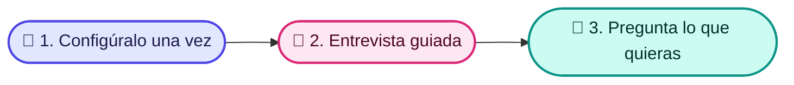

<p align="center">
  
</p>

<p align="center">
  <a href="https://opensource.org/licenses/MIT"></a>
  
  
  
</p>

<p align="center">
  🇬🇧 <a href="./README.md">English</a> · 🇪🇸 <strong>Español</strong>
</p>

# 🧠 Copilot Brain

**Tu asistente de IA responde las preguntas de tu equipo con los documentos de tu propia empresa, muestra de dónde sale cada respuesta y nunca inventa nada.**

## 🧩 El problema que resuelve

- 🌀 **El conocimiento está disperso.** Vive en la cabeza de las personas, en documentos antiguos y en conversaciones de chat, y nadie lo encuentra cuando lo necesita.
- 🎲 **Las herramientas de IA inventan respuestas.** Un asistente genérico adivina tus precios, políticas y procesos.
- 🔁 **Las personas nuevas hacen las mismas preguntas.** Cada nueva incorporación interrumpe a alguien para aprender cómo funcionan las cosas.

## 👀 Míralo en acción

*Ejemplos ilustrativos, no conversaciones grabadas. Las respuestas provienen de los documentos de ejemplo incluidos en Copilot Brain (escritos en inglés).*

> [!NOTE]
> **💼 Un vendedor pregunta: "El prospecto dice que es demasiado caro. ¿Qué le respondo?"**
>
> "Entiendo que el control del presupuesto es estricto ahora mismo. Permíteme preguntar: ¿cuánto tiempo de desarrollo se dedicó el mes pasado a corregir código alucinado por IA o a buscar especificaciones desactualizadas?" Luego ofrece una revisión de ROI de 20 minutos.
>
> 📄 *Fuente: pricing-too-high*

> [!TIP]
> **🛠️ La persona de guardia pregunta: "Acaba de empezar un incidente P1. ¿Qué hago?"**
>
> Reconoce la alerta en menos de 5 minutos y nombra a un responsable del incidente. El responsable de comunicaciones publica una actualización de estado en menos de 15 minutos. Revierte los cambios recientes hasta que los errores se mantengan por debajo de 0.1% durante 10 minutos. ¿Sin respuesta en 7 minutos? Escala a la guardia de respaldo.
>
> 📄 *Fuente: incident-management*

> [!IMPORTANT]
> **💰 Un ejecutivo de cuentas pregunta: "¿Puedo dar un 25% de descuento?"**
>
> No por tu cuenta. Entre 21% y 30% requiere al VP de Ventas o al CRO, justificado con un caso de éxito público, derechos de logo o un webinar conjunto, y el cliente se compromete a un caso de éxito en 60 días. Tú puedes aprobar hasta 10% con pago anticipado de 12 meses.
>
> 📄 *Fuente: pricing-tiers-and-discount-matrix*

Si un documento aún no existe, el asistente lo indica y ofrece ayudarte a redactarlo.

## 🗂️ Qué puedes guardar

<table align="center">
  <tr>
    <td align="center" width="33%">💼<br><strong>Ventas</strong><br>Perfiles de cliente, respuestas a objeciones, comparativas con competidores, notas de llamadas<br><em>"¿Cómo le ganamos a nuestro principal competidor?"</em></td>
    <td align="center" width="33%">📣<br><strong>Marketing</strong><br>Guía de marca, mensajes clave, calendario de contenidos<br><em>"¿Cuál es nuestro pitch de 30 segundos?"</em></td>
    <td align="center" width="33%">🧭<br><strong>Producto</strong><br>Hoja de ruta, especificaciones, notas de versión<br><em>"¿Qué estamos construyendo este semestre?"</em></td>
  </tr>
  <tr>
    <td align="center" width="33%">🛠️<br><strong>Operaciones</strong><br>Procedimientos paso a paso, herramientas, proveedores<br><em>"¿Qué hago cuando empieza un incidente grave?"</em></td>
    <td align="center" width="33%">🧑‍🤝‍🧑<br><strong>Personas</strong><br>Manual de la empresa, evaluaciones de contratación, planes de incorporación<br><em>"¿Qué hace una nueva incorporación en sus primeros 30 días?"</em></td>
    <td align="center" width="33%">💰<br><strong>Finanzas y Legal</strong><br>Precios, reglas de descuento, plantillas de contratos<br><em>"¿Quién aprueba un 25% de descuento?"</em></td>
  </tr>
</table>

## ⚙️ Cómo funciona en 3 pasos

1. 🧰 **Alguien de tu equipo lo configura una sola vez** (unos 10 minutos).
2. 💬 **Una entrevista guiada con tu asistente de IA** lo llena con la información de tu empresa y redacta tus primeros documentos de cada área. Tú apruebas todo antes de que se guarde.
3. 🙋 **Todos hacen preguntas en lenguaje natural** y reciben respuestas con su fuente.



🎨 Consulta la guía visual: [Cómo usar Copilot Brain](./docs/diagrams/uso.html).

## 🤝 Funciona con las herramientas de IA que ya usas

- 🟠 **Claude**: Claude Code, la app de escritorio de Claude y Claude Projects en la web
- 🟣 **Cursor** y 🌊 **Windsurf**
- 🔷 **Gemini**: el asistente de programación Gemini de Google y Gemini Gems en la web
- 🟢 **ChatGPT**: como GPT personalizado

## 🔒 Tus datos siguen siendo tuyos

> [!IMPORTANT]
> - 📁 **Archivos normales que te pertenecen.** Todo se guarda como documentos comunes en una carpeta de tu computadora o de tu unidad compartida.
> - 🚫 **La herramienta no envía nada a ningún lado.** Solo lee y escribe esos archivos locales. El asistente de IA que conectes (Claude, ChatGPT, Gemini…) procesa tus preguntas bajo las condiciones de ese proveedor, así que elige uno en el que tu empresa confíe.
> - ✅ **Tú revisas cada cambio.** El asistente te muestra cada borrador y lo guarda solo cuando lo apruebas.

---

<details>
<summary>🛠️ Para quien lo configura: instalación</summary>

Requiere **Node.js 22+**. El paquete de npm aún no está publicado, así que se instala desde el código fuente:

```bash
git clone https://github.com/carlosleoncodepro/clc-copilot-brain.git
cd clc-copilot-brain
npm install
npm link                      # deja `clc-brain` disponible en tu PATH
clc-brain init ../acme-brain  # cerebro limpio por defecto
```

Abre `../acme-brain` en Claude Code o Cursor y ejecuta `/brain:onboarding`. Te entrevista una pregunta a la vez, completa `org-kernel.json` y `company-profile.md`, y luego redacta el primer activo de cada área activa (objeción y battlecard de ventas, un SOP de operaciones, `marketing/messaging/core-positioning.md`, `product/roadmap/q3-q4-product-themes.md`, `hr_people/handbook/company-handbook.md`, `finance_legal/pricing/pricing-tiers-and-discount-matrix.md`). Cada uno se guarda solo tras tu aprobación y se valida con `clc-brain doctor`.

- Datos de ejemplo para explorar: `clc-brain init ../demo-brain --demo`; elimínalos después con `clc-brain clean-demo ../demo-brain`.
- Cuando se publique, `npm install -g @clc/copilot-brain` reemplazará los pasos de clonar y enlazar.
</details>

<details>
<summary>🛠️ Para quien lo configura: conectar apps de IA</summary>

- **Claude Code, Cursor, Windsurf, Gemini CLI**: abre la carpeta del cerebro; no requiere configuración. `AGENTS.md` contiene las reglas y `CLAUDE.md`, `GEMINI.md`, `.cursorrules` y `.windsurfrules` apuntan a él.
- **Claude Desktop, Cursor, Zed y otros clientes MCP**: agrega esto a la configuración MCP de la app (p. ej. `claude_desktop_config.json`) con la ruta absoluta de tu cerebro:

  ```json
  {
    "mcpServers": {
      "copilot-brain": { "command": "clc-brain", "args": ["mcp", "/path/to/acme-brain"] }
    }
  }
  ```

  Expone las herramientas `brain_query`, `brain_capture_call`, `brain_capture_objection` y `brain_doctor`, además de `call`, `objection`, `battlecard`, `flow` y `retro` como prompts MCP.
- **ChatGPT, Gemini Gems, Claude Projects**: sigue las guías de copiar y pegar en `skills/integrations/` dentro del cerebro (`CHATGPT_CUSTOM_GPT.md`, `GEMINI_GEM.md`, `CLAUDE_PROJECT.md`).
</details>

<details>
<summary>🛠️ Para quien lo configura: hacer preguntas y atajos de ventas</summary>

**Cualquier área: lenguaje natural.** El asistente busca en el cerebro siguiendo `.agents/skills/brain-search.md` (vía MCP, la herramienta `brain_query`) y cita el archivo. `/brain` abre el panel.

**Atajos de ventas.** Hoy los comandos dedicados están enfocados en ventas:

| Comando | Qué hace |
| :--- | :--- |
| `/objection` | Obtiene la respuesta aprobada a una objeción o guarda una nueva. |
| `/battlecard` | Compara contra un competidor y entrega tus argumentos decisivos. |
| `/call` | Pega la transcripción de una llamada; extrae señales y la guarda en `sales/calls/YYYY-MM/`. |
| `/flow` | Consulta las reglas de las etapas del embudo o convierte una captura de un diagrama en Mermaid. |
| `/retro` | Retrospectiva mensual de llamadas y revisiones de ganados/perdidos (p. ej. `/retro 2026-10`). |

También disponibles: `/brain:onboarding`, `/brain:sales`, `/brain:doctor`, `/brain:add-area`. Las definiciones están en `.claude/commands/`.
</details>

<details>
<summary>🛠️ Para quien lo configura: guía de carpetas</summary>

| Ruta | Qué contiene |
| :--- | :--- |
| `company-profile.md`, `org-kernel.json` | Quiénes son, qué venden, áreas activas, responsable de gobierno. |
| `sales/` | `icps/`, `objections/`, `battlecards/`, `scripts/`, `calls/`, `stages/`, `win-loss/` |
| `marketing/` | `brand/`, `messaging/`, `content/`, `distribution/` |
| `product/` | `roadmap/`, `specs/`, `releases/` |
| `operations/` | `sops/`, `tools/`, `vendors/` |
| `hr_people/` | `handbook/`, `hiring/`, `onboarding/` |
| `finance_legal/` | `pricing/`, `compliance/` |
| `playbooks/` | Un playbook operativo por área. |
| `schemas/` | JSON Schemas del kernel, battlecards, objeciones y SOPs (verificados por `clc-brain doctor`). |

Agrega un área personalizada con `clc-brain add-area --custom <id>` o `/brain:add-area`.
</details>

<details>
<summary>🛠️ Para quien lo configura: comandos de terminal</summary>

| Comando | Qué hace |
| :--- | :--- |
| `clc-brain init [dir]` | Crea un cerebro. Limpio por defecto (también con `--yes`); `--demo` agrega ejemplos. |
| `clc-brain doctor [dir] [--fix]` | Valida esquemas y enlaces; `--fix` aplica reparaciones no destructivas. |
| `clc-brain add-area [dir] --preset <id>` | Agrega un área predefinida (`--custom <id>` para una propia). |
| `clc-brain list-areas [dir]` | Muestra las áreas instaladas y disponibles. |
| `clc-brain clean-demo [dir]` | Elimina los ejemplos y conserva tus datos reales. |
| `clc-brain mcp [dir]` | Inicia el servidor MCP por stdio. |

Ejecuta `clc-brain --help` para ver todas las opciones.
</details>

<details>
<summary>🛠️ Para quien lo configura: migrar documentos existentes</summary>

- **Texto (Notion, Google Docs, manuales, notas del CRM)**: pégalo en tu asistente y di *"Guarda esto en nuestro cerebro en operations/sops"* (o cualquier área), o usa `/call` para notas de reuniones. También puedes colocar archivos `.md` en la carpeta correspondiente.
- **Diagramas (Miro, Lucidchart, fotos de pizarra)**: arrastra la captura al chat y ejecuta `/flow` para convertirla en un diagrama Mermaid en `sales/stages/pipeline-stages.md`.
</details>

<details>
<summary>🛠️ Para quien lo configura: documentación técnica y licencia</summary>

- [TECHNICAL.md](./TECHNICAL.md): arquitectura, esquemas, protocolo MCP y guardas de auditoría.
- [docs/Journal/](./docs/Journal/): registros de decisiones de arquitectura.
- Licencia: MIT © [Carlos Leon Code Pro](https://github.com/carlosleoncodepro).
</details>

---

<p align="center">
  Hecho con ❤️ para equipos que quieren una IA que diga la verdad.<br>
  <sub>Licencia MIT © <a href="https://github.com/carlosleoncodepro">Carlos Leon Code Pro</a> · <a href="https://opensource.org/licenses/MIT">Licencia</a></sub>
</p>
