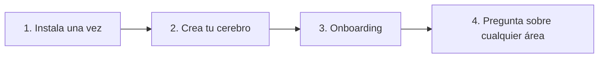

# Copilot Brain

**Todo el conocimiento de tu empresa (ventas, marketing, producto, operaciones, personas, finanzas y legal) en un solo repositorio desde el que responden los copilotos de IA, citando el archivo de origen y sin inventar nada.**

[](https://opensource.org/licenses/MIT)
[](https://nodejs.org/)
[](./TECHNICAL.md#3-model-context-protocol-mcp-specification)

[Read in English](./README.md) · [Documentación técnica](./TECHNICAL.md)

## Míralo en 30 segundos

> *Ejemplos ilustrativos, no sesiones grabadas. Cada respuesta proviene de un archivo de ejemplo en [`templates/areas/`](./templates/areas/) (su contenido está en inglés).*

```text
Vendedor:   /objection "es demasiado caro"
Copiloto:   Fuente: sales/objections/pricing-too-high.json
            Di esto: "Entiendo que el control del presupuesto es estricto ahora mismo.
            Permíteme preguntar: ¿cuánto tiempo de desarrollo se dedicó el mes pasado
            a corregir código alucinado por IA o a buscar especificaciones desactualizadas?"
            Siguiente paso: una revisión de ROI de 20 minutos con la calculadora de velocidad.

Guardia:    Acaba de empezar un incidente P1. ¿Qué hago?
Copiloto:   Fuente: operations/sops/incident-management.json
            1. Reconoce la alerta en PagerDuty en menos de 5 minutos, declara P0/P1 y nombra un Incident Commander.
            2. El responsable de comunicaciones publica en Statuspage en menos de 15 minutos.
            3. Revierte los despliegues recientes o desvía tráfico hasta que los errores bajen de 0.1% durante 10 minutos.
            ¿Sin respuesta en 7 minutos? Escala a la guardia secundaria.

Ejecutivo:  ¿Puedo dar un 25% de descuento?
Copiloto:   Fuente: finance_legal/pricing/pricing-tiers-and-discount-matrix.md
            Entre 21% y 30% requiere aprobación del VP de Ventas / CRO, justificada con un caso
            de éxito público, derechos de logo o un webinar conjunto. A cambio: caso de éxito y cita en 60 días.
            Tú puedes aprobar hasta 10% con pago anual anticipado de 12 meses.
```

Cada respuesta proviene de un archivo que tu equipo administra y revisa. Si el archivo no existe, el copiloto lo indica y ofrece crearlo.

## Qué vive en cada área

| Área | Carpetas | Pregunta de ejemplo |
| :--- | :--- | :--- |
| `sales` | `icps/`, `objections/`, `battlecards/`, `scripts/`, `calls/`, `stages/`, `win-loss/` | "¿Cómo le ganamos a <competidor>?" |
| `marketing` | `brand/`, `messaging/`, `content/`, `distribution/` | "¿Cuál es nuestro pitch de 30 segundos?" |
| `product` | `roadmap/`, `specs/`, `releases/` | "¿Qué estamos construyendo este semestre?" |
| `operations` | `sops/`, `tools/`, `vendors/` | "¿Qué hago cuando empieza un incidente P1?" |
| `hr_people` | `handbook/`, `hiring/`, `onboarding/` | "¿Qué hace una nueva incorporación en sus primeros 30 días?" |
| `finance_legal` | `pricing/`, `compliance/` | "¿Quién aprueba un 25% de descuento?" |

## Inicio rápido

Requiere **Node.js 22+**.

```bash
git clone https://github.com/carlosleoncodepro/clc-copilot-brain.git
cd clc-copilot-brain
npm install
npm link                      # deja `clc-brain` disponible en tu PATH
clc-brain init ../acme-brain  # cerebro limpio por defecto
```

Abre `../acme-brain` en Claude Code o Cursor y ejecuta `/brain:onboarding`.

- Para explorar primero con datos de ejemplo: `clc-brain init ../demo-brain --demo` (elimínalos después con `clc-brain clean-demo ../demo-brain`).
- Cuando el paquete se publique en npm, `npm install -g @clc/copilot-brain` reemplazará los pasos de clonar y enlazar.

## Qué ocurre en el onboarding

`/brain:onboarding` te entrevista una pregunta a la vez (empresa, oferta, áreas, competidores, objeciones, responsable). Después:

1. Completa `org-kernel.json` y `company-profile.md`.
2. Redacta el **primer activo real de cada área que activaste**, con como máximo una pregunta adicional por área:

   | Área | Primer activo |
   | :--- | :--- |
   | `sales` | Una ficha de objeción y una battlecard (JSON validado por esquema) |
   | `operations` | Un primer SOP en `operations/sops/` (JSON validado por esquema) |
   | `marketing` | `marketing/messaging/core-positioning.md` |
   | `product` | `product/roadmap/q3-q4-product-themes.md` |
   | `hr_people` | `hr_people/handbook/company-handbook.md` |
   | `finance_legal` | `finance_legal/pricing/pricing-tiers-and-discount-matrix.md` |

3. Te muestra cada borrador y lo guarda solo cuando lo apruebas (puedes omitir cualquier área); luego valida con `clc-brain doctor`.

Termina con una pregunta de ejemplo por cada área sembrada, para que pruebes **tus** datos de inmediato.

## Uso diario

**Cualquier área: pregunta en lenguaje natural.** *"¿Cuál es nuestra licencia parental?"*, *"¿Quién aprueba un 25% de descuento?"*, *"Explícame nuestro SOP de incidentes."* El copiloto busca en el cerebro (ver `.agents/skills/brain-search.md`; vía MCP, la herramienta `brain_query`) y cita el archivo. `/brain` abre el panel.

**Atajos de ventas.** Hoy los comandos dedicados están enfocados en ventas:

| Comando | Qué hace |
| :--- | :--- |
| `/objection` | Obtiene la respuesta aprobada a una objeción o guarda una nueva. |
| `/battlecard` | Compara contra un competidor y entrega tus argumentos decisivos. |
| `/call` | Pega la transcripción de una llamada; extrae señales y la guarda en `sales/calls/YYYY-MM/`. |
| `/flow` | Consulta las reglas de las etapas del embudo o convierte una captura de un diagrama en Mermaid. |
| `/retro` | Retrospectiva mensual de llamadas y revisiones de ganados/perdidos (p. ej. `/retro 2026-10`). |

Consulta [todos los comandos](#todos-los-comandos).

## Conectar otras apps de IA

Abrir la carpeta del cerebro en **Claude Code, Cursor, Windsurf o Gemini CLI** no requiere configuración: `AGENTS.md` contiene las reglas y `CLAUDE.md`, `GEMINI.md`, `.cursorrules` y `.windsurfrules` apuntan a él.

<details>
<summary>Claude Desktop, Cursor, Zed y otros clientes MCP</summary>

Agrega esto a la configuración MCP de tu app (p. ej. `claude_desktop_config.json`) con la ruta absoluta de tu cerebro:

```json
{
  "mcpServers": {
    "copilot-brain": { "command": "clc-brain", "args": ["mcp", "/path/to/acme-brain"] }
  }
}
```

Expone las herramientas `brain_query`, `brain_capture_call`, `brain_capture_objection` y `brain_doctor`, además de `call`, `objection`, `battlecard`, `flow` y `retro` como prompts MCP.
</details>

<details>
<summary>ChatGPT, Gemini y Claude en la web</summary>

Dentro de tu cerebro, sigue las guías de copiar y pegar en `skills/integrations/`: `CHATGPT_CUSTOM_GPT.md`, `GEMINI_GEM.md` o `CLAUDE_PROJECT.md`.
</details>

## Cómo funciona



Guía visual: [docs/diagrams/uso.html](./docs/diagrams/uso.html).

<details>
<summary>Guía de carpetas</summary>

| Ruta | Qué contiene |
| :--- | :--- |
| `company-profile.md`, `org-kernel.json` | Quiénes son, qué venden, áreas activas, responsable de gobierno. |
| `<área>/` | Una carpeta por área activa (ver [Qué vive en cada área](#qué-vive-en-cada-área)). |
| `sales/objections/`, `sales/battlecards/` | JSON estructurado (+ Markdown) validado contra `schemas/`. |
| `operations/sops/` | Procedimientos paso a paso, JSON validado contra `schemas/sop.schema.json`. |
| `playbooks/` | Un playbook operativo por área. |
| `schemas/` | JSON Schemas del kernel, battlecards, objeciones y SOPs. |

Agrega un área personalizada con `clc-brain add-area --custom <id>` o `/brain:add-area`.
</details>

<details>
<summary>Comandos de terminal</summary>

| Comando | Qué hace |
| :--- | :--- |
| `clc-brain init [dir]` | Crea un cerebro. Limpio por defecto (también con `--yes`); `--demo` agrega ejemplos. |
| `clc-brain doctor [dir] [--fix]` | Valida esquemas y enlaces; `--fix` aplica reparaciones no destructivas. |
| `clc-brain add-area [dir] --preset <id>` | Agrega un área predefinida (`--custom <id>` para una propia). |
| `clc-brain list-areas [dir]` | Muestra las áreas instaladas y disponibles. |
| `clc-brain clean-demo [dir]` | Elimina los ejemplos y conserva tus datos reales. |
| `clc-brain mcp [dir]` | Inicia el servidor MCP por stdio. |

Ejecuta `clc-brain --help` para ver todas las opciones.
</details>

<details>
<summary>Migrar documentos existentes</summary>

- **Texto (Notion, Google Docs, manuales, notas del CRM)**: pégalo en tu copiloto y di *"Guarda esto en nuestro cerebro en operations/sops"* (o cualquier área), o usa `/call` para notas de reuniones. También puedes colocar archivos `.md` en la carpeta correspondiente.
- **Diagramas (Miro, Lucidchart, fotos de pizarra)**: arrastra la captura al chat y ejecuta `/flow` para convertirla en un diagrama Mermaid en `sales/stages/pipeline-stages.md`.
</details>

### Todos los comandos

`/objection`, `/battlecard`, `/call`, `/flow`, `/retro`, además de `/brain` (panel), `/brain:onboarding` (entrevista), `/brain:sales` (copiloto de ventas), `/brain:doctor` (revisión de salud) y `/brain:add-area` (crear áreas y fichas). Las definiciones están en `.claude/commands/`.

## Más información

- [TECHNICAL.md](./TECHNICAL.md): arquitectura, esquemas, protocolo MCP y guardas de auditoría.
- [docs/Journal/](./docs/Journal/): registros de decisiones de arquitectura.
- Licencia: MIT © [Carlos Leon Code Pro](https://github.com/carlosleoncodepro).
