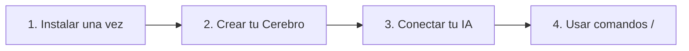

# Copilot Brain 🧠

> **La Memoria Viva para tu Empresa y tus Asistentes de IA.**  
> Organiza tus notas de llamadas comerciales, respuestas a objeciones, fichas de competidores, diagramas de flujo de ventas y manuales operativos en un solo lugar — para que tu asistente de IA responda con la verdad de tu negocio y nunca vuelva a inventar información.

[](https://opensource.org/licenses/MIT)
[](https://nodejs.org/)
[](./TECHNICAL.md#3-model-context-protocol-mcp-specification)

---

<p align="center">
  <a href="./README.md"><strong>🇺🇸 Read this guide in English</strong></a> &bull;
  <a href="./TECHNICAL.md"><strong>🛠️ Guía Técnica y de Arquitectura (TECHNICAL.md)</strong></a>
</p>

---

## ¿Por qué usar Copilot Brain?

Toda empresa en crecimiento enfrenta los mismos tres problemas:

1. **Los documentos importantes quedan olvidados**: Las notas en Notion, Google Docs o carpetas sueltas se escriben una vez y nadie vuelve a encontrarlas dos semanas después.
2. **Cada persona del equipo responde algo distinto**: Un vendedor ofrece un descuento o función especial; otro dice que no está permitido.
3. **Los asistentes de IA inventan respuestas**: Cuando le pides a una IA genérica que redacte una propuesta o responda una objeción, adivina tus precios e inventa características porque no conoce las reglas reales de tu empresa.

**Copilot Brain** soluciona esto. Crea una carpeta ordenada en tu computadora (o repositorio compartido del equipo) que se conecta directamente con tu asistente de IA favorito. Cada vez que haces una pregunta o escribes un comando rápido como `/call` u `/objection`, la IA consulta primero la información oficial de tu empresa.

---

## Inicio Rápido (En 3 Minutos, Sin Saber Programar)



### Paso 1: Instalar la Herramienta
Abre la aplicación **Terminal** (en Mac/Linux) o **PowerShell** (en Windows) y ejecuta este comando:

```bash
npm install -g @clc/copilot-brain
```

### Paso 2: Crear el Cerebro de tu Empresa
Crea una carpeta nueva, entra en ella e inicia el asistente:

```bash
mkdir cerebro-empresa
cd cerebro-empresa
clc-brain init
```

El asistente interactivo te hará 4 preguntas sencillas:
1. **Nombre de tu Empresa** (ej. *Acme Corp*)
2. **Industria o Sector** (ej. *Software B2B y Servicios*)
3. **Propuesta de Valor Principal**
4. **Áreas a Activar** (Ventas, Marketing, Producto, Operaciones, Recursos Humanos, Finanzas) y si prefieres iniciar con un **Repositorio Limpio** (recomendado para uso real) o con **Ejemplos de Demostración**.

---

## ¿Qué va en cada carpeta? (Mapa Práctico)

No necesitas adivinar dónde guardar cada documento. Puedes colocar tus archivos en estas carpetas o simplemente pegar la información en el chat para que la IA la guarde en el lugar correcto:

| Carpeta o Archivo | ¿Qué se guarda aquí? | Ejemplos Prácticos |
| :--- | :--- | :--- |
| **`company-profile.md`** | El resumen general de tu negocio | Qué vendes, a quién ayudas y cuál es tu propuesta de valor principal. |
| **`sales/calls/`** | Notas y transcripciones de llamadas | Transcripciones de Zoom/Meet, resúmenes de reuniones con clientes y acuerdos, organizados por mes (`YYYY-MM`). |
| **`sales/objections/`** | Respuestas a dudas y objeciones | Guiones aprobados para responder cuando un cliente dice *"Es muy caro"*, *"Ya trabajamos con otro proveedor"* o *"Lo vemos el próximo trimestre"*. |
| **`sales/battlecards/`** | Comparativas frente a competidores | Fichas prácticas con tus ventajas clave, puntos débiles de cada competidor y preguntas para ganar la negociación. |
| **`sales/stages/`** | **Flujos de venta y etapas del embudo** | El diagrama visual de tu proceso comercial (flujos Mermaid) y los requisitos para avanzar un trato de una etapa a otra. |
| **`sales/icps/`** | Perfil de cliente ideal | Quiénes son tus mejores compradores (cargos, problemas principales, presupuesto y señales de descarte). |
| **`operations/sops/`** | Manuales y procesos paso a paso | Listas de verificación operativas: cómo dar de alta a un cliente, cómo resolver soporte o procesos internos. |

---

## Cómo Migrar tus Documentos Actuales y Diagramas de Flujo

¿Ya tienes información en **Notion, Google Docs, Word, PDFs, Miro o Lucidchart**? Pasarla a tu Segundo Cerebro es muy sencillo:

### 1. Migrar Documentos de Texto (Notion, Google Docs, Notas de CRM)
- **Opción A (Pedirle a la IA que lo organice)**: Copia el texto de tu documento antiguo, pégalo en el chat de tu IA y escribe:
  > *"Guarda esta objeción de precio en nuestro Segundo Cerebro"* o *"Usa `/call` para analizar y guardar estas notas de reunión."*
- **Opción B (Copiar y Pegar Archivos)**: Guarda tus notas como archivos de texto o Markdown (`.md`) y colócalos directamente en la carpeta correspondiente (por ejemplo, `sales/scripts/` u `operations/sops/`).

### 2. Migrar Diagramas de Flujo Visuales (Capturas de Pantalla, Miro, Lucidchart, Pizarras)
¿Tienes el proceso de ventas o el recorrido del cliente dibujado en una imagen, PDF o pizarra?
1. **Toma una captura de pantalla** de tu diagrama (desde Miro, Lucidchart, Figma, una presentación o una foto de pizarra).
2. **Arrastra y suelta la imagen** directamente en el chat de tu asistente de IA.
3. **Escribe `/flow` o indícale a la IA**:
   > *"Convierte esta captura de pantalla de nuestro proceso de ventas en un diagrama interactivo Mermaid dentro de `sales/stages/pipeline-stages.md`."*

Tu asistente transformará la imagen en un diagrama limpio y editable dentro de tu repositorio, listo para que cualquier persona del equipo o asistente de IA pueda consultarlo y actualizarlo.

---

## Comandos Rápidos (`/`) en tu Chat de IA

No hace falta escribir instrucciones largas. Escribe cualquiera de estos comandos rápidos directamente en tu asistente:

| Comando | ¿Para qué sirve? | Ejemplo de Uso |
| :--- | :--- | :--- |
| **`/call`** | **Guardar y analizar una llamada o reunión.** Extrae puntos clave, objeciones y próximos pasos en `sales/calls/`. | `/call` + pega la transcripción o tus notas de la reunión. |
| **`/objection`** | **Obtener una respuesta inmediata a una objeción** o guardar una nueva en `sales/objections/`. | `/objection El cliente dice que la implementación toma demasiado tiempo.` |
| **`/battlecard`** | **Comparar contra un competidor en segundos** usando `sales/battlecards/`. | `/battlecard ¿Cómo nos diferenciamos frente al Competidor Alpha?` |
| **`/flow`** | **Consultar las reglas de tu embudo comercial o actualizar tu diagrama de flujo** en `sales/stages/pipeline-stages.md`. | `/flow ¿Qué requisitos necesitamos para pasar de Descubrimiento a Propuesta?` |
| **`/retro`** | **Ejecutar la retrospectiva mensual de ventas.** Resume tendencias de cierres y objeciones frecuentes del mes. | `/retro 2026-10` |
| **`/brain`** | **Abrir el panel principal del Segundo Cerebro** para ver las áreas activas y acciones disponibles. | `/brain` |
| **`/brain:onboarding`** | **Iniciar la entrevista guiada de configuración** (1 pregunta a la vez) para personalizar el perfil de tu empresa. | `/brain:onboarding` |
| **`/brain:doctor`** | **Revisar el estado de tu Segundo Cerebro** y reparar archivos faltantes automáticamente. | `/brain:doctor` |

---

## Funciona en Todas Partes (Compatibilidad Universal)

Copilot Brain utiliza estándares abiertos para que puedas trabajar con cualquier herramienta de IA:

### 1. Aplicaciones de Escritorio y Editores con IA (vía MCP)
Se conecta de forma nativa con **Claude Desktop, Cursor, OpenAI Codex, Google Antigravity, Windsurf, Zed y Gentle Dot**.
Solo agrega este bloque en el archivo de configuración MCP de tu aplicación (por ejemplo, `claude_desktop_config.json`):

```json
{
  "mcpServers": {
    "copilot-brain": {
      "command": "clc-brain",
      "args": ["mcp", "/ruta/completa/a/tu/cerebro-empresa"]
    }
  }
}
```
*(Reemplaza `/ruta/completa/a/tu/cerebro-empresa` por la ubicación real de la carpeta en tu computadora. Al reiniciar tu aplicación, tendrás activas tanto las herramientas de búsqueda como los comandos rápidos).*

### 2. Asistentes de Espacio de Trabajo (Configuración Automática)
Si abres la carpeta directamente en **Claude Code, Cursor, Windsurf o Gemini CLI**, todo funciona al instante sin configurar nada adicional:
- `AGENTS.md` funciona como la guía maestra única.
- `CLAUDE.md`, `GEMINI.md`, `.cursorrules` y `.windsurfrules` enlazan automáticamente a `AGENTS.md`.
- `.claude/commands/` habilita todos los comandos rápidos (`/call`, `/objection`, `/battlecard`, `/flow`, `/retro`, `/brain`).

### 3. ChatGPT y Google Gemini en el Navegador Web
¿Prefieres usar ChatGPT o Google Gemini desde la web?
- Abre la carpeta **`skills/integrations/`** dentro de tu Segundo Cerebro.
- Sigue los pasos de las guías `chatgpt-custom-gpt.md` o `gemini-gem.md` para crear en 2 minutos un GPT Personalizado o un Gem conectado a los documentos de tu empresa.

---

## Comandos Útiles en la Terminal

- **`clc-brain init`** — Crea un nuevo Segundo Cerebro (en modo Limpio o con Demostración).
- **`clc-brain clean-demo`** — Elimina los archivos de ejemplo en cualquier momento y deja solo la información real de tu empresa.
- **`clc-brain add-area`** — Agrega un nuevo departamento cuando lo necesites (ej. Producto, Recursos Humanos o Finanzas).
- **`clc-brain list-areas`** — Muestra qué departamentos están activos en tu repositorio.
- **`clc-brain doctor`** — Verifica que todos los archivos estén en orden y repara enlaces automáticamente (`--fix`).

---

## Documentación Técnica para Desarrolladores

¿Eres ingeniero de software o administrador de sistemas y buscas los esquemas JSON, detalles del protocolo MCP (`tools/list`, `tools/call`, `prompts/list`, `prompts/get`) o las pruebas automatizadas?
👉 **[Consulta la Guía de Arquitectura Técnica (TECHNICAL.md)](./TECHNICAL.md)**

---

## Licencia

Licencia MIT © [Carlos Leon Code Pro](https://github.com/carlosleoncodepro). Uso libre personal, comercial y empresarial.
