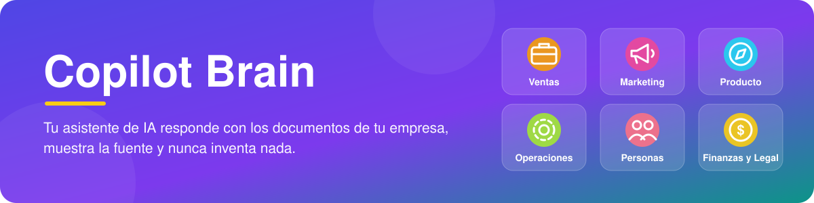
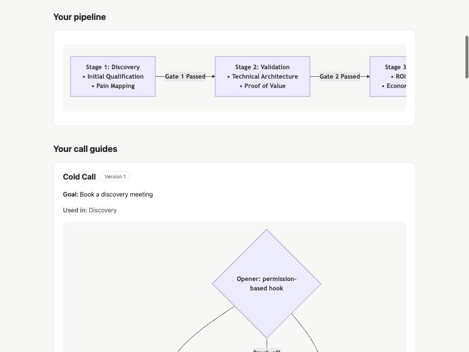

<p align="center">
  
</p>

<p align="center">
  <a href="https://opensource.org/licenses/MIT"></a>
  
  
  
</p>

<p align="center">
  🇬🇧 <a href="./README.md">English</a> · 🇪🇸 <strong>Español</strong>
</p>

# 🧠 Copilot Brain

**Tu asistente de IA responde las preguntas de tu equipo con los documentos de tu propia empresa, muestra de dónde sale cada respuesta y nunca inventa nada.**

## 🧩 El problema que resuelve

- 🌀 **El conocimiento está disperso.** Vive en la cabeza de las personas, en documentos antiguos y en conversaciones de chat, y nadie lo encuentra cuando lo necesita.
- 🎲 **Las herramientas de IA inventan respuestas.** Un asistente genérico adivina tus precios, políticas y procesos.
- 🔁 **Las personas nuevas hacen las mismas preguntas.** Cada nueva incorporación interrumpe a alguien para aprender cómo funcionan las cosas.

## 👀 Míralo en acción

*Ejemplos ilustrativos, no conversaciones grabadas. Las respuestas provienen de los documentos de ejemplo incluidos en Copilot Brain (escritos en inglés).*

> [!NOTE]
> **💼 Un vendedor pregunta: "El prospecto dice que es demasiado caro. ¿Qué le respondo?"**
>
> "Entiendo que el control del presupuesto es estricto ahora mismo. Permíteme preguntar: ¿cuánto tiempo de desarrollo se dedicó el mes pasado a corregir código alucinado por IA o a buscar especificaciones desactualizadas?" Luego ofrece una revisión de ROI de 20 minutos.
>
> 📄 *Fuente: pricing-too-high*

> [!TIP]
> **🛠️ La persona de guardia pregunta: "Acaba de empezar un incidente P1. ¿Qué hago?"**
>
> Reconoce la alerta en menos de 5 minutos y nombra a un responsable del incidente. El responsable de comunicaciones publica una actualización de estado en menos de 15 minutos. Revierte los cambios recientes hasta que los errores se mantengan por debajo de 0.1% durante 10 minutos. ¿Sin respuesta en 7 minutos? Escala a la guardia de respaldo.
>
> 📄 *Fuente: incident-management*

> [!IMPORTANT]
> **💰 Un ejecutivo de cuentas pregunta: "¿Puedo dar un 25% de descuento?"**
>
> No por tu cuenta. Entre 21% y 30% requiere al VP de Ventas o al CRO, justificado con un caso de éxito público, derechos de logo o un webinar conjunto, y el cliente se compromete a un caso de éxito en 60 días. Tú puedes aprobar hasta 10% con pago anticipado de 12 meses.
>
> 📄 *Fuente: pricing-tiers-and-discount-matrix*

Si un documento aún no existe, el asistente lo indica y ofrece ayudarte a redactarlo.

También puedes pedirle que te *muestre* cosas: *"Muéstrame mi proceso de ventas"* abre tus pasos de venta y tus guías de llamada como una página visual sencilla.

## 🗂️ Qué puedes guardar

<table align="center">
  <tr>
    <td align="center" width="33%">💼<br><strong>Ventas</strong><br>Tu proceso de ventas, guías de llamada, respuestas a objeciones, comparativas con competidores, notas de llamadas<br><em>"¿Cómo le ganamos a nuestro principal competidor?"</em></td>
    <td align="center" width="33%">📣<br><strong>Marketing</strong><br>Guía de marca, mensajes clave, calendario de contenidos<br><em>"¿Cuál es nuestro pitch de 30 segundos?"</em></td>
    <td align="center" width="33%">🧭<br><strong>Producto</strong><br>Hoja de ruta, especificaciones, notas de versión<br><em>"¿Qué estamos construyendo este semestre?"</em></td>
  </tr>
  <tr>
    <td align="center" width="33%">🛠️<br><strong>Operaciones</strong><br>Procedimientos paso a paso, herramientas, proveedores<br><em>"¿Qué hago cuando empieza un incidente grave?"</em></td>
    <td align="center" width="33%">🧑‍🤝‍🧑<br><strong>Personas</strong><br>Manual de la empresa, evaluaciones de contratación, planes de incorporación<br><em>"¿Qué hace una nueva incorporación en sus primeros 30 días?"</em></td>
    <td align="center" width="33%">💰<br><strong>Finanzas y Legal</strong><br>Precios, reglas de descuento, plantillas de contratos<br><em>"¿Quién aprueba un 25% de descuento?"</em></td>
  </tr>
</table>

## ⚙️ Cómo funciona en 3 pasos

1. 🧰 **Alguien de tu equipo lo configura una sola vez** (unos 10 minutos).
2. 💬 **Una entrevista guiada con tu asistente de IA** lo llena con la información de tu empresa y redacta tus primeros documentos de cada área. Tú apruebas todo antes de que se guarde. El asistente te guía desde el primer "hola": si el cerebro todavía no está configurado, te ofrece empezar.
3. 🙋 **Todos preguntan con sus propias palabras** y reciben respuestas con su fuente. No hay comandos especiales que aprender.


🎨 Consulta la guía visual de lo básico: [Cómo usar Copilot Brain](./docs/diagrams/uso.html).

## 💬 Pide las cosas con tus palabras

Nunca necesitas aprender un comando. Escribe lo que quieres, en español o en inglés:

| Di esto | Qué pasa |
| :--- | :--- |
| *"¿Qué puedes hacer?"* | Un menú corto de lo que tu cerebro puede hacer por ti. |
| *"Configuremos mi cerebro"* | La entrevista guiada, una pregunta a la vez. |
| *"Registra esta llamada"* (y pega tus notas) | Tu asistente resume la llamada en una frase y la guarda cuando le dices que sí. |
| *"¿Cómo vamos?"* | Números sencillos sobre qué está funcionando en ventas. |
| *"¿Cómo me fue este mes?"* | Una revisión mensual con cambios que puedes aceptar o descartar. |
| *"Muéstrame mi proceso de ventas"* | Abre la página visual de tu proceso de ventas. |
| *"Este es mi flujo de ventas"* | Trae un proceso que ya tienes dibujado en otro lado. |
| *"Clasifica mis llamadas viejas"* | Ordena las notas de llamadas anteriores para que cuenten en los números. |
| *"Pon mi cerebro en español"* | Cambia el idioma de tu cerebro. |
| *"Revisa mi cerebro"* | Una revisión de estado, explicada con palabras sencillas. |
| *"Actualiza mi cerebro"* | Lleva tu cerebro a la última versión, cuando estés de acuerdo. |

## 💼 Tu sistema de ventas

Tu cerebro trae un sistema de ventas listo para usar que puedes adaptar a la forma en que vende tu equipo.

- 🗺️ **Un mapa de tu proceso de ventas**: los pasos por los que pasa cada negocio.
- 📞 **Guías de llamada** para una llamada en frío, una llamada de descubrimiento, una demo y un seguimiento. Cada guía dice qué decir, qué hacer si la llamada va por un lado o por otro, y **qué significa tener éxito** en esa llamada (por ejemplo, "reunión agendada").
- 🧭 **Tipos de venta**: prospección en frío, solicitudes entrantes, referidos y clientes actuales. Puedes agregar los tuyos.
- 📝 **Notas de llamadas**: después de cada llamada, di *"Registra esta llamada"*. Tu asistente anota el tipo de venta, de dónde vino el contacto y si la llamada cumplió su objetivo, y te pregunta antes de guardar.
- 📅 **Una revisión mensual**: pregunta *"¿Cómo me fue este mes?"*. Tu asistente lee los números reales, propone cambios a tus guías y no cambia nada hasta que lo apruebas.
- 🎬 **Guiones para cualquier industria**: di *"Hazme un guion para restaurantes"*. Tu asistente te pregunta por tus clientes y tus palabras, te muestra una vista previa y lo guarda solo cuando dices que sí. Se abre como una página visual que puedes leer durante una llamada.
- 📖 **Un glosario**: pregunta *"¿Qué significa MEDDPICC?"* y recibe una respuesta clara. El asistente puede añadir los términos que usa tu equipo, y aparecen en tu página de ventas.

### 👁️ Mira tu proceso de ventas

Tu asistente convierte tus pasos de venta y tus guías de llamada en una página visual sencilla que puedes abrir en tu navegador. Solo pide *"Muéstrame mi proceso de ventas"*. La página se actualiza sola cada vez que cambia una guía y funciona sin conexión a internet. La página usa el idioma del cerebro (español o inglés).

La página también muestra qué está funcionando, por tipo de venta, guía de llamada y persona, con números sencillos. Pregunta: *"¿Cómo vamos?"*

Su sección **"Cómo vamos"** muestra:

- 📊 Resultados por tipo de venta, por guía de llamada (comparada con su propia definición de éxito) y por persona.
- 🎯 En qué punto las llamadas suelen no cumplir su objetivo.
- 🗓️ Lo que va del mes junto al último mes completo.
- ⏳ "Todavía es pronto para sacar conclusiones" cuando hay pocas llamadas, para que nadie decida con muy pocos datos.
- 🧪 Los documentos de ejemplo nunca se cuentan.

<p align="center">
  
</p>

### 📥 ¿Ya tienes tu proceso dibujado?

Di *"Este es mi flujo de ventas"* y compártelo: una foto de una pizarra, un PDF, una exportación de Miro o Archify, o simplemente una descripción.

1. 🔎 Tu asistente te explica lo que entendió y pregunta lo que no está claro, una pregunta a la vez.
2. 👀 Te muestra una vista previa de la página con tu flujo.
3. ✅ Lo guarda solo cuando le dices que sí.

Cambiar un paso o mejorar una guía más adelante funciona igual: explica, muestra la vista previa y guarda después de un sí.

## 🤝 Funciona con las herramientas de IA que ya usas

Cualquier herramienta de IA que pueda abrir una carpeta de tu computadora funciona sin configuración extra:

- 🟠 **Claude Code**, y la pestaña Code de la app de escritorio de Claude
- ⚫ **Codex**
- 🛸 **Google Antigravity**
- 🟣 **Cursor** y 🌊 **Windsurf**
- 🔷 **Gemini CLI**

Las apps de chat que no pueden abrir carpetas (ChatGPT, Gemini Gems, Claude Projects) se configuran copiando y pegando. Mira [Conecta tu herramienta de IA](#-conecta-tu-herramienta-de-ia).

🌎 Funciona en español e inglés.

## 🔒 Tus datos siguen siendo tuyos

> [!IMPORTANT]
> - 📁 **Archivos normales que te pertenecen.** Todo se guarda como documentos comunes en una carpeta de tu computadora o de tu unidad compartida.
> - 🚫 **La herramienta no envía nada a ningún lado.** Solo lee y escribe esos archivos locales, y la página de ventas funciona sin conexión. El asistente de IA que uses (Claude, ChatGPT, Gemini…) procesa tus preguntas bajo las condiciones de ese proveedor, así que elige uno en el que tu empresa confíe.
> - ✅ **Tú revisas cada cambio.** El asistente te muestra cada borrador y lo guarda solo cuando lo apruebas.

---

## 🚀 Empezar

La configuración se hace **una sola vez**, y la hace alguien del equipo que se sienta cómodo escribiendo algunos comandos. Toma unos 10 minutos.

1. 🧰 Instala Copilot Brain en la computadora (mira la guía de abajo).
2. 🧠 Crea el cerebro de tu empresa y elige su idioma.
3. 📂 Abre la carpeta del cerebro en tu herramienta de IA y di *"Configuremos mi cerebro"* (o simplemente *"hola"*: el asistente te guía desde el primer "hola").

<details>
<summary><strong>Guía de instalación paso a paso</strong></summary>

<br>

**Antes de empezar:** necesitas [Node.js](https://nodejs.org/) 22 o superior. Compruébalo con:

```bash
node -v
```

**1. Descarga Copilot Brain e instálalo**

Copilot Brain todavía no está en npm, así que se instala desde su código fuente:

```bash
git clone https://github.com/carlosleoncode/clc-copilot-brain.git
cd clc-copilot-brain
npm install
npm link
```

`npm link` deja disponible el comando `clc-brain` en cualquier lugar de tu computadora. Comprueba que apunta a la copia que acabas de descargar (macOS y Linux):

```bash
readlink -f "$(command -v clc-brain)"
```

El resultado debe terminar en `clc-copilot-brain/bin/cli.js` dentro de la carpeta que acabas de clonar.

> [!WARNING]
> Si antes enlazaste una copia más antigua, el comando puede seguir apuntando a ella. Ejecuta `npm link` otra vez desde la carpeta nueva (o primero `npm unlink -g @clc/copilot-brain`) y vuelve a comprobarlo.

**2. Crea el cerebro de tu empresa**

```bash
clc-brain init ../acme-brain
```

Responde unas preguntas (idioma, nombre de la empresa, industria, áreas). Para elegir el idioma desde el principio, añade `--language es` (español) o `--language en` (inglés); por defecto se usa el idioma de tu computadora. La página de ventas usa el idioma del cerebro, y `clc-brain stats` también. Con `--language es` también recibes las guías iniciales en español (el mapa de ventas, el proceso de venta y las guías de llamada). Verás **"Second Brain initialized successfully!"** y luego tus próximos pasos.

Para saltarte las preguntas, pasa todo como opciones:

```bash
clc-brain init ../acme-brain --yes --language es --name "Acme" --industry "SaaS" --tagline "Vender sin complicaciones" --areas "sales,operations"
```

> [!TIP]
> ¿Quieres explorar primero? Ejecuta `clc-brain init ../demo-brain --demo` para obtener un cerebro con documentos de ejemplo. Elimínalos después con `clc-brain clean-demo ../demo-brain`. Un cerebro sin ejemplos (`--clean`) es la opción por defecto.

**3. Ábrelo con tu asistente de IA**

Abre la carpeta `acme-brain` en Claude Code, Codex, Google Antigravity, Cursor, Windsurf o Gemini CLI. No hace falta configurar nada más. ¿Usas otra app? Mira [Conecta tu herramienta de IA](#-conecta-tu-herramienta-de-ia).

¿No sabes qué sigue? Ejecuta `clc-brain` solo dentro de la carpeta: te muestra dónde estás y el siguiente paso.

**4. Haz la entrevista guiada**

Di *"Configuremos mi cerebro"* (también puedes escribir `/brain-onboarding`). El asistente hace una pregunta a la vez, completa el perfil de tu empresa y redacta un primer documento para cada área. Apruebas cada borrador antes de que se guarde.

**5. Comprueba que todo esté bien**

```bash
clc-brain doctor ../acme-brain
```

Deberías ver **0 errores**. Si falta algo, `clc-brain doctor ../acme-brain --fix` lo repara sin tocar tus documentos.

<sub>Cuando Copilot Brain se publique en npm, el paso 1 será un solo comando: `npm install -g @clc/copilot-brain`.</sub>

</details>

## 🔄 Actualiza un cerebro existente

Cuando sale una versión nueva, la persona que instaló Copilot Brain descarga la última versión y luego le pide al asistente *"Actualiza mi cerebro"*. El asistente explica qué cambiaría y solo actualiza cuando le dices que sí. Tus propios documentos y notas de llamadas nunca se sobrescriben.

<details>
<summary><strong>Guía de actualización paso a paso</strong></summary>

<br>

**1. Descarga la última versión**

```bash
cd clc-copilot-brain
git pull
npm install
npm link   # solo si la comprobación de abajo apunta a otro lugar
readlink -f "$(command -v clc-brain)"
```

**2. Previsualiza la actualización y luego aplícala**

```bash
clc-brain upgrade ../acme-brain --dry-run
clc-brain upgrade ../acme-brain --yes
```

`--dry-run` muestra qué se agregaría o cambiaría, sin escribir nada. Revísalo y luego ejecútalo con `--yes`. Qué hace la actualización:

- Se renuevan los atajos y las instrucciones del asistente que vienen incluidos. Si personalizaste alguno, tu versión se conserva al lado como copia `.bak`. Si todavía hay un `.bak` de una actualización anterior, ese archivo se omite y se avisa; mueve el `.bak` antiguo a otro lugar y vuelve a ejecutarlo.
- Se renuevan las reglas del asistente al inicio de `AGENTS.md` (con una copia `.bak`); lo que escribiste fuera de ellas queda igual.
- Las guías de llamada que ya tienes nunca se sobrescriben. Las guías iniciales nuevas se agregan en el idioma del cerebro.
- Tus notas de llamadas, análisis de negocios ganados y perdidos y demás documentos nunca se tocan.

O sáltate los comandos y di *"Actualiza mi cerebro"*: el asistente hace la misma vista previa y la aplica solo cuando estás de acuerdo.

**3. Después de actualizar un cerebro antiguo**

Pídele a tu asistente, en este orden:

1. *"Pon mi cerebro en español"* (solo si quieres español y el cerebro sigue en inglés).
2. *"Este es mi flujo de ventas"*, y comparte el proceso que ya usas.
3. *"Clasifica mis llamadas viejas"*, para que las llamadas anteriores cuenten en los números.
4. *"Muéstrame mi proceso de ventas"*.

</details>

## 🔌 Conecta tu herramienta de IA

Abre solo la que usas.

<details>
<summary><strong>Claude Code · Codex · Antigravity · Cursor · Windsurf · Gemini CLI · Claude de escritorio (pestaña Code)</strong></summary>

<br>

Abre la carpeta de tu cerebro. Eso es todo: cada herramienta lee las reglas de `AGENTS.md`, directamente o a través de `CLAUDE.md`, `GEMINI.md`, `.cursorrules` y `.windsurfrules`. Las personas piden las cosas con sus palabras y el asistente sigue el procedimiento correcto.

Los comandos con barra como `/call` o `/flow` son atajos opcionales que funcionan en todas estas herramientas (mira "Comandos con barra en cada asistente" más abajo). Nadie los necesita.

La página de ventas funciona en cualquiera de estas herramientas: cuando pides *"Muéstrame mi proceso de ventas"*, el asistente ejecuta `clc-brain view --open` por ti. Si no puede ejecutar comandos, abre `sales/sales-system.html` en tu navegador.

</details>

<details>
<summary><strong>ChatGPT · Gemini Gems · Claude Projects</strong></summary>

<br>

Estas apps no pueden abrir tu carpeta, así que sigue la guía de copiar y pegar que está dentro de tu cerebro:

| App | Guía |
| :--- | :--- |
| ChatGPT (GPT personalizado) | `skills/integrations/CHATGPT_CUSTOM_GPT.md` |
| Gemini Gems | `skills/integrations/GEMINI_GEM.md` |
| Claude Projects | `skills/integrations/CLAUDE_PROJECT.md` |

</details>

<details>
<summary><strong>Opcional: apps de chat con una conexión MCP</strong></summary>

<br>

Solo para apps de chat que no pueden abrir carpetas pero aceptan servidores MCP (por ejemplo, el chat de Claude de escritorio). Agrega esto a la configuración MCP de la app (en Claude Desktop: `claude_desktop_config.json`) con la ruta completa a tu cerebro; `clc-brain init` lo imprime con tu ruta ya completada:

```json
{
  "mcpServers": {
    "acme-brain": { "command": "clc-brain", "args": ["mcp", "/ruta/completa/a/acme-brain"] }
  }
}
```

Reinicia la app. Podrá buscar en el cerebro, guardar notas de llamadas y objeciones, y revisar su estado. La página de ventas y los números de ventas necesitan una herramienta con acceso a la carpeta.

</details>

## 📥 Trae tus documentos existentes

- **Textos** de Notion, Google Docs, manuales o notas del CRM: pégalos en tu asistente y di *"Guarda esto en nuestro cerebro, en operaciones"* (o cualquier área).
- **Notas de reuniones**: pégalas y di *"Registra esta llamada"*.
- **Flujos de venta** de Miro, Archify, Lucidchart, un PDF o una foto de pizarra: compártelo y di *"Este es mi flujo de ventas"*.

## 📚 Referencia

<details>
<summary><strong>Comandos con barra en cada asistente (opcionales)</strong></summary>

<br>

Todo lo de abajo también funciona pidiéndolo con tus palabras, en cualquier herramienta. Los comandos con barra son una entrada más rápida. Cada uno es una skill en `.agents/skills/<nombre>/SKILL.md`; `clc-brain init` y `clc-brain upgrade` generan los archivos extra que algunos asistentes necesitan (`.claude/skills/`, `.gemini/commands/`, `.windsurf/workflows/`). Edita la skill, nunca los archivos generados, y luego ejecuta `clc-brain upgrade`.

| Asistente | Cómo usar un atajo |
| :--- | :--- |
| Claude Code | Escribe `/call` (desde `.claude/skills/`). |
| Codex | Escribe `$call`, o elígelo en `/skills`. |
| Google Antigravity | Escribe `/call`, o simplemente pídelo: las skills se cargan cuando encajan. |
| Cursor | Escribe `/call` en el chat del agente. |
| OpenCode | Escribe `/call`. |
| Windsurf | Escribe `/call` (workflow de `.windsurf/workflows/`). |
| Gemini CLI | Escribe `/call` (comando de `.gemini/commands/`). |
| GitHub Copilot | Escribe `/call` en modo agente, o simplemente pídelo. |

Los cerebros anteriores usaban nombres con dos puntos (`/brain:onboarding`); ahora son `/brain-onboarding`, `/brain-sales`, `/brain-doctor` y `/brain-add-area`. `clc-brain upgrade` elimina los archivos viejos de `.claude/commands/` que nunca cambiaste y te avisa de los que sí.

| Atajo | Qué hace |
| :--- | :--- |
| `/brain` | Resumen de tu cerebro y de lo que puedes hacer. |
| `/brain-onboarding` | Entrevista guiada que configura tu cerebro. |
| `/brain-sales` | Ayuda de ventas: respuestas a objeciones, comparativas con competidores, qué decir. |
| `/objection` | Respuesta aprobada a una objeción de un comprador, o guarda una nueva. |
| `/battlecard` | Cómo te comparas con un competidor. |
| `/call` | Analiza las notas de una llamada y las guarda. |
| `/flow` | Ve o cambia tu proceso de ventas y tus guías de llamada, o trae un flujo que ya tienes. |
| `/script` | Escribe o mejora un guion para cualquier industria, míralo como página y cuida el glosario. |
| `/retro` | Revisión mensual de llamadas y negocios ganados o perdidos. |
| `/brain-add-area` | Agrega una nueva área o documento. |
| `/brain-doctor` | Revisión de estado desde el chat. |
| `/brain-search` | Encuentra la respuesta en cualquier área de tu cerebro. |
| `/sales-assist` | Redacta mensajes y prepara llamadas con la guía de llamada correcta. |
| `/sop-auditor` | Revisa un procedimiento (SOP) en busca de huecos. |

</details>

<details>
<summary><strong>Comandos de terminal</strong></summary>

<br>

| Comando | Qué hace |
| :--- | :--- |
| `clc-brain init [carpeta]` | Crea un cerebro. Opciones: `--language en\|es`, `--name`, `--industry`, `--tagline`, `--areas`, `--demo` o `--clean` (por defecto), `--yes`. |
| `clc-brain doctor [carpeta]` | Revisa el estado; agrega `--fix` para reparar. |
| `clc-brain add-area [carpeta]` | Agrega un área: `--preset operations` o `--custom legal_ops`. |
| `clc-brain list-areas [carpeta]` | Muestra las áreas instaladas y disponibles. |
| `clc-brain clean-demo [carpeta]` | Elimina los documentos de ejemplo y conserva los tuyos. |
| `clc-brain upgrade [carpeta] [--dry-run] [--yes]` | Actualiza un cerebro existente a los últimos comandos y skills; tus ediciones quedan como copias `.bak`. `--dry-run` previsualiza, `--yes` aplica. |
| `clc-brain view [carpeta] [--open] [--draft <archivo>]` | Crea la página visual de tu proceso de ventas; añade `--open` para abrirla en tu navegador, o `--draft <archivo>` para ver un cambio antes de guardarlo. |
| `clc-brain stats [carpeta] [--month YYYY-MM] [--json]` | Muestra qué está funcionando en tus ventas (por tipo de venta, guía de llamada y persona) este mes y el anterior; `--json` da los números en bruto. |
| `clc-brain mcp [carpeta]` | Inicia la conexión MCP opcional (la usa la configuración de arriba). |

`clc-brain --help` muestra todas las opciones. `copilot-brain` es el mismo comando con otro nombre.

</details>

<details>
<summary><strong>Idiomas</strong></summary>

<br>

- Cada cerebro tiene un idioma, español o inglés (`language` en `org-kernel.json`). `init --language es|en` lo define; sin esa opción, `init` usa el idioma de tu computadora.
- El asistente habla y escribe el contenido nuevo en el idioma del cerebro, y responde en el idioma en que le escriba cada persona.
- Los cerebros en español reciben el mapa de ventas, el proceso de venta y las cuatro guías de llamada en español, y una página de ventas y un reporte de `stats` en español.
- Los documentos iniciales de las demás áreas (marketing, producto, operaciones, personas, finanzas y legal) por ahora están en inglés. El asistente puede traducirlos cuando se lo pidas.
- Para cambiarlo más adelante, di *"Pon mi cerebro en español"*.

</details>

<details>
<summary><strong>Qué hay dentro de un cerebro</strong></summary>

<br>

| Carpeta | Qué se guarda |
| :--- | :--- |
| `company-profile.md` | Quiénes son y qué venden. |
| `sales/system.md` | El mapa de tu proceso de ventas. |
| `sales/plays/` | Las guías de llamada (llamada en frío, descubrimiento, demo, seguimiento), cada una con su objetivo y su definición de éxito. |
| `sales/stages/` | Los pasos de tu proceso de ventas y lo que debe cumplirse antes de avanzar. |
| `sales/calls/` | Notas de llamadas, una carpeta por mes. |
| `sales/win-loss/` | Análisis de negocios ganados y perdidos. |
| `sales/scripts/` | Tus guiones, un archivo cada uno, con una página visual generada al lado. |
| `sales/glossary.md` | Tus términos y lo que significan (se crea con el primer término). |
| `sales/` (otras carpetas) | Perfiles de cliente, objeciones, comparativas con competidores, calificación, casos de éxito. |
| `sales/sales-system.html` | La página visual de tu proceso de ventas (se crea sola; ábrela en cualquier navegador). |
| `marketing/` | Marca, mensajes, calendario de contenidos, distribución. |
| `product/` | Hoja de ruta, especificaciones, notas de versión. |
| `operations/` | Procedimientos paso a paso, herramientas, proveedores. |
| `hr_people/` | Manual, evaluaciones de contratación, planes de incorporación. |
| `finance_legal/` | Precios, reglas de descuento, plantillas de contratos. |
| `playbooks/` | Una guía operativa por área. |
| `AGENTS.md` | Las reglas que sigue cualquier herramienta de IA en este cerebro. |

Para desarrolladores: [TECHNICAL.md](./TECHNICAL.md) describe la arquitectura, el modelo de datos y las reglas de validación, y [docs/Journal/](./docs/Journal/) registra las decisiones de diseño.

</details>

---

<p align="center">
  Hecho con ❤️ para equipos que quieren una IA que diga la verdad.<br>
  <sub>Licencia MIT © <a href="https://github.com/carlosleoncode">Carlos Leon Code</a> · <a href="https://opensource.org/licenses/MIT">Licencia</a></sub>
</p>
