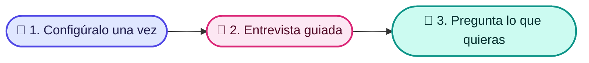

<p align="center">
  
</p>

<p align="center">
  <a href="https://opensource.org/licenses/MIT"></a>
  
  
  
</p>

<p align="center">
  🇬🇧 <a href="./README.md">English</a> · 🇪🇸 <strong>Español</strong>
</p>

# 🧠 Copilot Brain

**Tu asistente de IA responde las preguntas de tu equipo con los documentos de tu propia empresa, muestra de dónde sale cada respuesta y nunca inventa nada.**

## 🧩 El problema que resuelve

- 🌀 **El conocimiento está disperso.** Vive en la cabeza de las personas, en documentos antiguos y en conversaciones de chat, y nadie lo encuentra cuando lo necesita.
- 🎲 **Las herramientas de IA inventan respuestas.** Un asistente genérico adivina tus precios, políticas y procesos.
- 🔁 **Las personas nuevas hacen las mismas preguntas.** Cada nueva incorporación interrumpe a alguien para aprender cómo funcionan las cosas.

## 👀 Míralo en acción

*Ejemplos ilustrativos, no conversaciones grabadas. Las respuestas provienen de los documentos de ejemplo incluidos en Copilot Brain (escritos en inglés).*

> [!NOTE]
> **💼 Un vendedor pregunta: "El prospecto dice que es demasiado caro. ¿Qué le respondo?"**
>
> "Entiendo que el control del presupuesto es estricto ahora mismo. Permíteme preguntar: ¿cuánto tiempo de desarrollo se dedicó el mes pasado a corregir código alucinado por IA o a buscar especificaciones desactualizadas?" Luego ofrece una revisión de ROI de 20 minutos.
>
> 📄 *Fuente: pricing-too-high*

> [!TIP]
> **🛠️ La persona de guardia pregunta: "Acaba de empezar un incidente P1. ¿Qué hago?"**
>
> Reconoce la alerta en menos de 5 minutos y nombra a un responsable del incidente. El responsable de comunicaciones publica una actualización de estado en menos de 15 minutos. Revierte los cambios recientes hasta que los errores se mantengan por debajo de 0.1% durante 10 minutos. ¿Sin respuesta en 7 minutos? Escala a la guardia de respaldo.
>
> 📄 *Fuente: incident-management*

> [!IMPORTANT]
> **💰 Un ejecutivo de cuentas pregunta: "¿Puedo dar un 25% de descuento?"**
>
> No por tu cuenta. Entre 21% y 30% requiere al VP de Ventas o al CRO, justificado con un caso de éxito público, derechos de logo o un webinar conjunto, y el cliente se compromete a un caso de éxito en 60 días. Tú puedes aprobar hasta 10% con pago anticipado de 12 meses.
>
> 📄 *Fuente: pricing-tiers-and-discount-matrix*

Si un documento aún no existe, el asistente lo indica y ofrece ayudarte a redactarlo.

También puedes pedirle que te *muestre* cosas: *"Muéstrame mi proceso de ventas"* abre tus pasos de venta y tus guías de llamada como una página visual sencilla.

## 🗂️ Qué puedes guardar

<table align="center">
  <tr>
    <td align="center" width="33%">💼<br><strong>Ventas</strong><br>Perfiles de cliente, respuestas a objeciones, comparativas con competidores, notas de llamadas<br><em>"¿Cómo le ganamos a nuestro principal competidor?"</em></td>
    <td align="center" width="33%">📣<br><strong>Marketing</strong><br>Guía de marca, mensajes clave, calendario de contenidos<br><em>"¿Cuál es nuestro pitch de 30 segundos?"</em></td>
    <td align="center" width="33%">🧭<br><strong>Producto</strong><br>Hoja de ruta, especificaciones, notas de versión<br><em>"¿Qué estamos construyendo este semestre?"</em></td>
  </tr>
  <tr>
    <td align="center" width="33%">🛠️<br><strong>Operaciones</strong><br>Procedimientos paso a paso, herramientas, proveedores<br><em>"¿Qué hago cuando empieza un incidente grave?"</em></td>
    <td align="center" width="33%">🧑‍🤝‍🧑<br><strong>Personas</strong><br>Manual de la empresa, evaluaciones de contratación, planes de incorporación<br><em>"¿Qué hace una nueva incorporación en sus primeros 30 días?"</em></td>
    <td align="center" width="33%">💰<br><strong>Finanzas y Legal</strong><br>Precios, reglas de descuento, plantillas de contratos<br><em>"¿Quién aprueba un 25% de descuento?"</em></td>
  </tr>
</table>

## ⚙️ Cómo funciona en 3 pasos

1. 🧰 **Alguien de tu equipo lo configura una sola vez** (unos 10 minutos).
2. 💬 **Una entrevista guiada con tu asistente de IA** lo llena con la información de tu empresa y redacta tus primeros documentos de cada área. Tú apruebas todo antes de que se guarde.
3. 🙋 **Todos hacen preguntas en lenguaje natural** y reciben respuestas con su fuente, y pueden ver los flujos de venta como una página visual sencilla.



🎨 Consulta la guía visual: [Cómo usar Copilot Brain](./docs/diagrams/uso.html).

## 👁️ Mira tu proceso de ventas

Tu asistente convierte tus pasos de venta y tus guías de llamada en una página visual sencilla que puedes abrir en tu navegador. Solo pide *"Muéstrame mi proceso de ventas"*. La página se actualiza sola cada vez que cambia una guía y funciona sin conexión a internet.

La página también muestra qué está funcionando, por tipo de venta, guía de llamada y persona, con números sencillos. Pregunta: *"¿Cómo vamos?"*

¿Ya tienes tu proceso dibujado en algún lado? Comparte una foto, un PDF o un archivo con tu asistente: te explica lo que entendió, te muestra una vista previa y lo guarda solo cuando le dices que sí.

<p align="center">
  
</p>

## 🤝 Funciona con las herramientas de IA que ya usas

- 🟠 **Claude**: Claude Code, la app de escritorio de Claude y Claude Projects en la web
- 🟣 **Cursor** y 🌊 **Windsurf**
- 🔷 **Gemini**: el asistente de programación Gemini de Google y Gemini Gems en la web
- 🟢 **ChatGPT**: como GPT personalizado

🌎 Funciona en español e inglés.

## 🔒 Tus datos siguen siendo tuyos

> [!IMPORTANT]
> - 📁 **Archivos normales que te pertenecen.** Todo se guarda como documentos comunes en una carpeta de tu computadora o de tu unidad compartida.
> - 🚫 **La herramienta no envía nada a ningún lado.** Solo lee y escribe esos archivos locales. El asistente de IA que conectes (Claude, ChatGPT, Gemini…) procesa tus preguntas bajo las condiciones de ese proveedor, así que elige uno en el que tu empresa confíe.
> - ✅ **Tú revisas cada cambio.** El asistente te muestra cada borrador y lo guarda solo cuando lo apruebas.

---

## 🚀 Empezar

La configuración se hace **una sola vez**, y la hace alguien del equipo que se sienta cómodo escribiendo algunos comandos. Toma unos 10 minutos.

<details>
<summary><strong>Guía de instalación paso a paso</strong></summary>

<br>

**Antes de empezar:** necesitas [Node.js](https://nodejs.org/) 22 o superior. Compruébalo con:

```bash
node -v
```

**1. Descarga Copilot Brain e instálalo**

```bash
git clone https://github.com/carlosleoncode/clc-copilot-brain.git
cd clc-copilot-brain
npm install
npm link
```

`npm link` deja disponible el comando `clc-brain` en cualquier lugar de tu computadora.

**2. Crea el cerebro de tu empresa**

```bash
clc-brain init ../acme-brain
```

Responde unas preguntas (idioma, nombre de la empresa, industria, áreas). Para elegir el idioma desde el principio, añade `--language es` (español) o `--language en` (inglés); por defecto se usa el idioma de tu computadora. La página de ventas usa el idioma del cerebro, y `clc-brain stats` también. Verás **"Second Brain initialized successfully!"** y luego tus próximos pasos.

> [!TIP]
> ¿Quieres explorar primero? Ejecuta `clc-brain init ../demo-brain --demo` para obtener un cerebro con documentos de ejemplo. Elimínalos después con `clc-brain clean-demo ../demo-brain`.

**3. Ábrelo con tu asistente de IA**

Abre la carpeta `acme-brain` en Claude Code, Cursor, Windsurf o Gemini CLI. No hace falta configurar nada más. ¿Usas otra app? Mira [Conecta tu herramienta de IA](#-conecta-tu-herramienta-de-ia).

**4. Haz la entrevista guiada**

Escribe `/brain:onboarding`. El asistente hace una pregunta a la vez, completa el perfil de tu empresa y redacta un primer documento para cada área. Apruebas cada borrador antes de que se guarde.

**5. Comprueba que todo esté bien**

```bash
clc-brain doctor ../acme-brain
```

Deberías ver **0 errores**. Si falta algo, `clc-brain doctor ../acme-brain --fix` lo repara sin tocar tus documentos.

**¿Ya tienes un cerebro?** Dile a tu asistente "Actualiza mi cerebro": tu asistente puede actualizarlo por ti y te pregunta antes de cambiar algo. También puedes ejecutar `clc-brain upgrade ../acme-brain` tú mismo.

<sub>Cuando Copilot Brain se publique en npm, el paso 1 será un solo comando: `npm install -g @clc/copilot-brain`.</sub>

</details>

## 🔌 Conecta tu herramienta de IA

Abre solo la que usas.

<details>
<summary><strong>Claude Code · Cursor · Windsurf · Gemini CLI</strong></summary>

<br>

Abre la carpeta de tu cerebro. Eso es todo: las reglas de `AGENTS.md` se cargan solas a través de `CLAUDE.md`, `GEMINI.md`, `.cursorrules` y `.windsurfrules`.

La página de tu proceso de ventas funciona en cualquier herramienta: cuando pides *"Muéstrame mi proceso de ventas"*, el asistente ejecuta `clc-brain view --open` por ti. Si no puede ejecutar comandos, abre `sales/sales-system.html` en tu navegador.

</details>

<details>
<summary><strong>Claude Desktop y otras apps MCP</strong></summary>

<br>

Agrega esto a la configuración MCP de la app (en Claude Desktop: `claude_desktop_config.json`), con la ruta completa a tu cerebro. `clc-brain init` imprime este bloque con tu ruta ya completada.

```json
{
  "mcpServers": {
    "acme-brain": { "command": "clc-brain", "args": ["mcp", "/ruta/completa/a/acme-brain"] }
  }
}
```

Reinicia la app. Tu asistente ya puede buscar en el cerebro, guardar notas de llamadas y objeciones, y revisar su estado.

</details>

<details>
<summary><strong>ChatGPT · Gemini Gems · Claude Projects</strong></summary>

<br>

Sigue la guía de copiar y pegar que está dentro de tu cerebro:

| App | Guía |
| :--- | :--- |
| ChatGPT (GPT personalizado) | `skills/integrations/CHATGPT_CUSTOM_GPT.md` |
| Gemini Gems | `skills/integrations/GEMINI_GEM.md` |
| Claude Projects | `skills/integrations/CLAUDE_PROJECT.md` |

</details>

## 📥 Trae tus documentos existentes

- **Textos** de Notion, Google Docs, manuales o notas del CRM: pégalos en tu asistente y di *"Guarda esto en nuestro cerebro, en operaciones"* (o cualquier área).
- **Notas de reuniones**: pega la transcripción y escribe `/call`.
- **Diagramas** de Miro, Lucidchart o una foto de pizarra: suelta la imagen en el chat y escribe `/flow`.

## 📚 Referencia

<details>
<summary><strong>Atajos dentro de tu asistente de IA</strong></summary>

<br>

Para cualquier área, pregunta en lenguaje natural. Estos atajos agilizan las tareas comunes:

| Atajo | Qué hace |
| :--- | :--- |
| `/brain` | Resumen de tu cerebro y de lo que puedes hacer. |
| `/brain:onboarding` | Entrevista guiada que configura tu cerebro. |
| `/objection` | Respuesta aprobada a una objeción de un comprador, o guarda una nueva. |
| `/battlecard` | Cómo te comparas con un competidor. |
| `/call` | Analiza la transcripción de una llamada y la guarda. |
| `/flow` | Reglas de las etapas de venta, o convierte la imagen de un diagrama. |
| `/retro` | Revisión mensual de llamadas y negocios ganados o perdidos. |
| `/brain:add-area` | Agrega una nueva área o documento. |
| `/brain:doctor` | Revisión de estado desde el chat. |

</details>

<details>
<summary><strong>Comandos de terminal</strong></summary>

<br>

| Comando | Qué hace |
| :--- | :--- |
| `clc-brain init [carpeta]` | Crea un cerebro (limpio por defecto, `--demo` para ejemplos). |
| `clc-brain doctor [carpeta]` | Revisa el estado; agrega `--fix` para reparar. |
| `clc-brain add-area [carpeta]` | Agrega un área: `--preset operations` o `--custom legal_ops`. |
| `clc-brain list-areas [carpeta]` | Muestra las áreas instaladas y disponibles. |
| `clc-brain clean-demo [carpeta]` | Elimina los documentos de ejemplo y conserva los tuyos. |
| `clc-brain upgrade [carpeta]` | Actualiza un cerebro existente a los últimos comandos y skills; tus ediciones quedan como copias `.bak`. Agrega `--dry-run` para previsualizar. |
| `clc-brain view [carpeta] [--open] [--draft <archivo>]` | Crea la página visual de tu proceso de ventas; añade `--open` para abrirla en tu navegador, o `--draft <archivo>` para ver un cambio antes de guardarlo. |
| `clc-brain stats [carpeta] [--month YYYY-MM] [--json]` | Muestra qué está funcionando en tus ventas (por tipo de venta, guía de llamada y persona) este mes y el anterior; `--json` da los números en bruto. |
| `clc-brain mcp [carpeta]` | Conecta apps MCP (lo usa la configuración de arriba). |

`clc-brain --help` muestra todas las opciones.

</details>

<details>
<summary><strong>Qué hay dentro de un cerebro</strong></summary>

<br>

| Carpeta | Qué se guarda |
| :--- | :--- |
| `company-profile.md` | Quiénes son y qué venden. |
| `sales/` | Perfiles de cliente, objeciones, comparativas con competidores, guiones, llamadas, etapas de venta, análisis de negocios ganados y perdidos. |
| `sales/sales-system.html` | La página visual de tu proceso de ventas (se crea sola; ábrela en cualquier navegador). |
| `marketing/` | Marca, mensajes, calendario de contenidos, distribución. |
| `product/` | Hoja de ruta, especificaciones, notas de versión. |
| `operations/` | Procedimientos paso a paso, herramientas, proveedores. |
| `hr_people/` | Manual, evaluaciones de contratación, planes de incorporación. |
| `finance_legal/` | Precios, reglas de descuento, plantillas de contratos. |
| `playbooks/` | Una guía operativa por área. |

Para desarrolladores: [TECHNICAL.md](./TECHNICAL.md) describe la arquitectura y las reglas de validación, y [docs/Journal/](./docs/Journal/) registra las decisiones de diseño.

</details>

---

<p align="center">
  Hecho con ❤️ para equipos que quieren una IA que diga la verdad.<br>
  <sub>Licencia MIT © <a href="https://github.com/carlosleoncode">Carlos Leon Code</a> · <a href="https://opensource.org/licenses/MIT">Licencia</a></sub>
</p>
