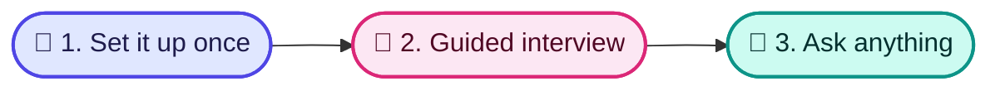

<p align="center">
  
</p>

<p align="center">
  <a href="https://opensource.org/licenses/MIT"></a>
  
  
  
</p>

<p align="center">
  🇬🇧 <strong>English</strong> · 🇪🇸 <a href="./README.es.md">Español</a>
</p>

# 🧠 Copilot Brain

**Your AI assistant answers your team's questions using your company's own documents, shows where each answer came from, and never makes things up.**

## 🧩 The problem it solves

- 🌀 **Knowledge is scattered.** It lives in people's heads, old documents and chat threads, and nobody finds it when they need it.
- 🎲 **AI tools invent answers.** A generic assistant guesses your prices, policies and processes.
- 🔁 **New people ask the same questions.** Every new hire or rep interrupts someone to learn how things work.

## 👀 See it in action

*Illustrative examples, not recorded conversations. The answers come from the sample documents included with Copilot Brain.*

> [!NOTE]
> **💼 A sales rep asks: "The prospect says it's too expensive. What do I say?"**
>
> "I completely understand that budget scrutiny is strict right now. Let me ask: how much developer time was spent last month refactoring hallucinated AI code or tracking down outdated API specs?" Then offer a 20-minute ROI review.
>
> 📄 *Source: pricing-too-high*

> [!TIP]
> **🛠️ The on-call engineer asks: "A P1 incident just started. What do I do?"**
>
> Acknowledge the alert within 5 minutes and name an incident lead. The communications lead posts a status update within 15 minutes. Roll back recent changes until errors stay below 0.1% for 10 minutes. No response in 7 minutes? Escalate to the backup on-call.
>
> 📄 *Source: incident-management*

> [!IMPORTANT]
> **💰 An account executive asks: "Can I give a 25% discount?"**
>
> Not on your own. 21–30% needs the VP of Sales or CRO, justified by a public case study, logo rights or a joint webinar, and the customer owes a case study within 60 days. You can approve up to 10% with a 12-month prepayment.
>
> 📄 *Source: pricing-tiers-and-discount-matrix*

If a document doesn't exist yet, the assistant says so and offers to help you write it.

## 🗂️ What you can keep in it

<table align="center">
  <tr>
    <td align="center" width="33%">💼<br><strong>Sales</strong><br>Customer profiles, objection replies, competitor comparisons, call notes<br><em>"How do we beat our main competitor?"</em></td>
    <td align="center" width="33%">📣<br><strong>Marketing</strong><br>Brand guidelines, key messages, content calendar<br><em>"What is our elevator pitch?"</em></td>
    <td align="center" width="33%">🧭<br><strong>Product</strong><br>Roadmap, feature specs, release notes<br><em>"What are we building this half?"</em></td>
  </tr>
  <tr>
    <td align="center" width="33%">🛠️<br><strong>Operations</strong><br>Step-by-step procedures, tools, vendors<br><em>"What do I do when a major incident starts?"</em></td>
    <td align="center" width="33%">🧑‍🤝‍🧑<br><strong>People</strong><br>Handbook, hiring scorecards, onboarding plans<br><em>"What does a new hire do in the first 30 days?"</em></td>
    <td align="center" width="33%">💰<br><strong>Finance &amp; Legal</strong><br>Pricing, discount rules, contract templates<br><em>"Who approves a 25% discount?"</em></td>
  </tr>
</table>

## ⚙️ How it works in 3 steps

1. 🧰 **Someone on your team sets it up once** (about 10 minutes).
2. 💬 **A guided interview with your AI assistant** fills it with your company's information and drafts your first documents for each area. You approve everything before it's saved.
3. 🙋 **Everyone asks questions in plain language** and gets answers with their source.



🎨 See the visual guide (in Spanish): [How to use Copilot Brain](./docs/diagrams/uso.html).

## 🤝 Works with the AI tools you already use

- 🟠 **Claude**: Claude Code, the Claude desktop app, and Claude Projects on the web
- 🟣 **Cursor** and 🌊 **Windsurf**
- 🔷 **Gemini**: Google's Gemini coding assistant, and Gemini Gems on the web
- 🟢 **ChatGPT**: as a custom GPT

## 🔒 Your data stays yours

> [!IMPORTANT]
> - 📁 **Plain files you own.** Everything is saved as ordinary documents in a folder on your computer or shared drive.
> - 🚫 **The tool itself sends nothing anywhere.** It only reads and writes those local files. Whichever AI assistant you connect (Claude, ChatGPT, Gemini…) handles your questions under that provider's own terms, so choose one your company trusts.
> - ✅ **You review every change.** The assistant shows you each draft and saves it only after you approve.

---

<details>
<summary>🛠️ For the person setting it up: installation</summary>

Requires **Node.js 22+**. The npm package is not published yet, so install from source:

```bash
git clone https://github.com/carlosleoncodepro/clc-copilot-brain.git
cd clc-copilot-brain
npm install
npm link                      # makes `clc-brain` available on your PATH
clc-brain init ../acme-brain  # clean brain by default
```

Open `../acme-brain` in Claude Code or Cursor and run `/brain:onboarding`. It interviews you one question at a time, fills `org-kernel.json` and `company-profile.md`, then drafts the first asset per active area (sales objection + battlecard, an operations SOP, `marketing/messaging/core-positioning.md`, `product/roadmap/q3-q4-product-themes.md`, `hr_people/handbook/company-handbook.md`, `finance_legal/pricing/pricing-tiers-and-discount-matrix.md`). Each one is saved only after approval and validated with `clc-brain doctor`.

- Sample data to explore: `clc-brain init ../demo-brain --demo`; remove it later with `clc-brain clean-demo ../demo-brain`.
- Once published, `npm install -g @clc/copilot-brain` will replace the clone + link steps.
</details>

<details>
<summary>🛠️ For the person setting it up: connecting AI apps</summary>

- **Claude Code, Cursor, Windsurf, Gemini CLI**: open the brain folder; no setup. `AGENTS.md` holds the rules and `CLAUDE.md`, `GEMINI.md`, `.cursorrules` and `.windsurfrules` point to it.
- **Claude Desktop, Cursor, Zed and other MCP clients**: add this to the app's MCP config (e.g. `claude_desktop_config.json`) with the absolute path of your brain:

  ```json
  {
    "mcpServers": {
      "copilot-brain": { "command": "clc-brain", "args": ["mcp", "/path/to/acme-brain"] }
    }
  }
  ```

  It exposes the tools `brain_query`, `brain_capture_call`, `brain_capture_objection` and `brain_doctor`, plus `call`, `objection`, `battlecard`, `flow` and `retro` as MCP prompts.
- **ChatGPT, Gemini Gems, Claude Projects**: follow the copy-paste guides in the brain's `skills/integrations/` (`CHATGPT_CUSTOM_GPT.md`, `GEMINI_GEM.md`, `CLAUDE_PROJECT.md`).
</details>

<details>
<summary>🛠️ For the person setting it up: asking questions and sales shortcuts</summary>

**Any area: plain language.** The assistant searches the brain following `.agents/skills/brain-search.md` (over MCP, the `brain_query` tool) and cites the file. `/brain` opens the dashboard.

**Sales shortcuts.** Today the dedicated slash commands are sales-focused:

| Command | What it does |
| :--- | :--- |
| `/objection` | Get the approved reply to a buyer objection, or save a new one. |
| `/battlecard` | Compare against a competitor and get your silver bullets. |
| `/call` | Paste a call transcript; it extracts signals and saves it to `sales/calls/YYYY-MM/`. |
| `/flow` | Check pipeline stage rules, or turn a flowchart screenshot into a Mermaid diagram. |
| `/retro` | Monthly retrospective across calls and win/loss reviews (e.g. `/retro 2026-10`). |

Also available: `/brain:onboarding`, `/brain:sales`, `/brain:doctor`, `/brain:add-area`. Definitions live in `.claude/commands/`.
</details>

<details>
<summary>🛠️ For the person setting it up: folder guide</summary>

| Path | What goes inside |
| :--- | :--- |
| `company-profile.md`, `org-kernel.json` | Who you are, what you sell, active areas, governance owner. |
| `sales/` | `icps/`, `objections/`, `battlecards/`, `scripts/`, `calls/`, `stages/`, `win-loss/` |
| `marketing/` | `brand/`, `messaging/`, `content/`, `distribution/` |
| `product/` | `roadmap/`, `specs/`, `releases/` |
| `operations/` | `sops/`, `tools/`, `vendors/` |
| `hr_people/` | `handbook/`, `hiring/`, `onboarding/` |
| `finance_legal/` | `pricing/`, `compliance/` |
| `playbooks/` | One operating playbook per area. |
| `schemas/` | JSON Schemas for the kernel, battlecards, objections and SOPs (checked by `clc-brain doctor`). |

Add a custom area with `clc-brain add-area --custom <id>` or `/brain:add-area`.
</details>

<details>
<summary>🛠️ For the person setting it up: terminal commands</summary>

| Command | What it does |
| :--- | :--- |
| `clc-brain init [dir]` | Create a brain. Clean by default (also with `--yes`); `--demo` adds samples. |
| `clc-brain doctor [dir] [--fix]` | Validate schemas and links; `--fix` applies non-destructive repairs. |
| `clc-brain add-area [dir] --preset <id>` | Add a preset area later (`--custom <id>` for your own). |
| `clc-brain list-areas [dir]` | Show installed vs available areas. |
| `clc-brain clean-demo [dir]` | Remove demo samples, keep your real data. |
| `clc-brain mcp [dir]` | Start the MCP server over stdio. |

Run `clc-brain --help` for every flag.
</details>

<details>
<summary>🛠️ For the person setting it up: migrating existing documents</summary>

- **Text (Notion, Google Docs, handbooks, CRM notes)**: paste it into your assistant and say *"Save this into our brain under operations/sops"* (or any area), or use `/call` for meeting notes. You can also drop `.md` files into the matching folder.
- **Flowcharts (Miro, Lucidchart, whiteboard photos)**: drop the screenshot into the chat and run `/flow` to convert it into a Mermaid diagram in `sales/stages/pipeline-stages.md`.
</details>

<details>
<summary>🛠️ For the person setting it up: technical docs and license</summary>

- [TECHNICAL.md](./TECHNICAL.md): architecture, schemas, MCP protocol, audit guards.
- [docs/Journal/](./docs/Journal/): architecture decision records.
- License: MIT © [Carlos Leon Code Pro](https://github.com/carlosleoncodepro).
</details>

---

<p align="center">
  Made with ❤️ for teams who want AI that tells the truth.<br>
  <sub>MIT License © <a href="https://github.com/carlosleoncodepro">Carlos Leon Code Pro</a> · <a href="https://opensource.org/licenses/MIT">License</a></sub>
</p>
