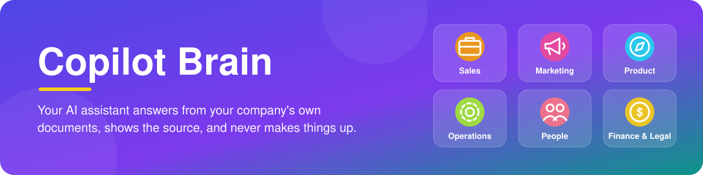
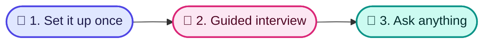

<p align="center">
  
</p>

<p align="center">
  <a href="https://opensource.org/licenses/MIT"></a>
  
  
  
</p>

<p align="center">
  🇬🇧 <strong>English</strong> · 🇪🇸 <a href="./README.es.md">Español</a>
</p>

# 🧠 Copilot Brain

**Your AI assistant answers your team's questions using your company's own documents, shows where each answer came from, and never makes things up.**

## 🧩 The problem it solves

- 🌀 **Knowledge is scattered.** It lives in people's heads, old documents and chat threads, and nobody finds it when they need it.
- 🎲 **AI tools invent answers.** A generic assistant guesses your prices, policies and processes.
- 🔁 **New people ask the same questions.** Every new hire or rep interrupts someone to learn how things work.

## 👀 See it in action

*Illustrative examples, not recorded conversations. The answers come from the sample documents included with Copilot Brain.*

> [!NOTE]
> **💼 A sales rep asks: "The prospect says it's too expensive. What do I say?"**
>
> "I completely understand that budget scrutiny is strict right now. Let me ask: how much developer time was spent last month refactoring hallucinated AI code or tracking down outdated API specs?" Then offer a 20-minute ROI review.
>
> 📄 *Source: pricing-too-high*

> [!TIP]
> **🛠️ The on-call engineer asks: "A P1 incident just started. What do I do?"**
>
> Acknowledge the alert within 5 minutes and name an incident lead. The communications lead posts a status update within 15 minutes. Roll back recent changes until errors stay below 0.1% for 10 minutes. No response in 7 minutes? Escalate to the backup on-call.
>
> 📄 *Source: incident-management*

> [!IMPORTANT]
> **💰 An account executive asks: "Can I give a 25% discount?"**
>
> Not on your own. 21–30% needs the VP of Sales or CRO, justified by a public case study, logo rights or a joint webinar, and the customer owes a case study within 60 days. You can approve up to 10% with a 12-month prepayment.
>
> 📄 *Source: pricing-tiers-and-discount-matrix*

If a document doesn't exist yet, the assistant says so and offers to help you write it.

You can also ask to *see* things: *"Show me my sales process"* opens your sales steps and call guides as a simple visual page.

## 🗂️ What you can keep in it

<table align="center">
  <tr>
    <td align="center" width="33%">💼<br><strong>Sales</strong><br>Customer profiles, objection replies, competitor comparisons, call notes<br><em>"How do we beat our main competitor?"</em></td>
    <td align="center" width="33%">📣<br><strong>Marketing</strong><br>Brand guidelines, key messages, content calendar<br><em>"What is our elevator pitch?"</em></td>
    <td align="center" width="33%">🧭<br><strong>Product</strong><br>Roadmap, feature specs, release notes<br><em>"What are we building this half?"</em></td>
  </tr>
  <tr>
    <td align="center" width="33%">🛠️<br><strong>Operations</strong><br>Step-by-step procedures, tools, vendors<br><em>"What do I do when a major incident starts?"</em></td>
    <td align="center" width="33%">🧑‍🤝‍🧑<br><strong>People</strong><br>Handbook, hiring scorecards, onboarding plans<br><em>"What does a new hire do in the first 30 days?"</em></td>
    <td align="center" width="33%">💰<br><strong>Finance &amp; Legal</strong><br>Pricing, discount rules, contract templates<br><em>"Who approves a 25% discount?"</em></td>
  </tr>
</table>

## ⚙️ How it works in 3 steps

1. 🧰 **Someone on your team sets it up once** (about 10 minutes).
2. 💬 **A guided interview with your AI assistant** fills it with your company's information and drafts your first documents for each area. You approve everything before it's saved.
3. 🙋 **Everyone asks questions in plain language** and gets answers with their source, and can see the sales flows as a simple visual page.



🎨 See the visual guide (in Spanish): [How to use Copilot Brain](./docs/diagrams/uso.html).

## 👁️ See your sales process

Your assistant turns your sales steps and call guides into a simple visual page you can open in your browser. Just ask *"Show me my sales process"*. The page updates itself whenever a guide changes.

<p align="center">
  
</p>

## 🤝 Works with the AI tools you already use

- 🟠 **Claude**: Claude Code, the Claude desktop app, and Claude Projects on the web
- 🟣 **Cursor** and 🌊 **Windsurf**
- 🔷 **Gemini**: Google's Gemini coding assistant, and Gemini Gems on the web
- 🟢 **ChatGPT**: as a custom GPT

## 🔒 Your data stays yours

> [!IMPORTANT]
> - 📁 **Plain files you own.** Everything is saved as ordinary documents in a folder on your computer or shared drive.
> - 🚫 **The tool itself sends nothing anywhere.** It only reads and writes those local files. Whichever AI assistant you connect (Claude, ChatGPT, Gemini…) handles your questions under that provider's own terms, so choose one your company trusts.
> - ✅ **You review every change.** The assistant shows you each draft and saves it only after you approve.

---

## 🚀 Get started

Setup is done **once**, by someone on your team who is comfortable typing a few commands. It takes about 10 minutes.

<details>
<summary><strong>Step-by-step installation guide</strong></summary>

<br>

**Before you start:** you need [Node.js](https://nodejs.org/) 22 or newer. Check it with:

```bash
node -v
```

**1. Download Copilot Brain and install it**

```bash
git clone https://github.com/carlosleoncode/clc-copilot-brain.git
cd clc-copilot-brain
npm install
npm link
```

`npm link` makes the `clc-brain` command available anywhere on your computer.

**2. Create your company's brain**

```bash
clc-brain init ../acme-brain
```

Answer a few questions (company name, industry, areas). You'll see **"Second Brain initialized successfully!"** followed by your next steps.

> [!TIP]
> Want to look around first? Run `clc-brain init ../demo-brain --demo` to get a brain filled with sample documents. Remove them later with `clc-brain clean-demo ../demo-brain`.

**3. Open it with your AI assistant**

Open the `acme-brain` folder in Claude Code, Cursor, Windsurf or Gemini CLI. No extra setup is needed. Using another app? See [Connect your AI tool](#-connect-your-ai-tool).

**4. Run the guided interview**

Type `/brain:onboarding`. The assistant asks one question at a time, fills in your company profile and drafts a first document for each area. You approve each draft before it is saved.

**5. Check everything is healthy**

```bash
clc-brain doctor ../acme-brain
```

You should see **0 errors**. If something is missing, `clc-brain doctor ../acme-brain --fix` repairs it without touching your documents.

**Already have a brain?** Just tell your assistant "Update my brain": your assistant can update your brain for you and asks before changing anything. You can also run `clc-brain upgrade ../acme-brain` yourself.

<sub>Once Copilot Brain is published on npm, step 1 becomes a single command: `npm install -g @clc/copilot-brain`.</sub>

</details>

## 🔌 Connect your AI tool

Open only the one you use.

<details>
<summary><strong>Claude Code · Cursor · Windsurf · Gemini CLI</strong></summary>

<br>

Open your brain folder. That's it: the rules in `AGENTS.md` load automatically through `CLAUDE.md`, `GEMINI.md`, `.cursorrules` and `.windsurfrules`.

The sales process page works in any tool: when you ask *"Show me my sales process"*, the assistant runs `clc-brain view --open` for you. If it can't run commands, open `sales/sales-system.html` in your browser.

</details>

<details>
<summary><strong>Claude Desktop and other MCP apps</strong></summary>

<br>

Add this to the app's MCP settings (in Claude Desktop: `claude_desktop_config.json`), using the full path to your brain. `clc-brain init` prints this snippet with your path already filled in.

```json
{
  "mcpServers": {
    "acme-brain": { "command": "clc-brain", "args": ["mcp", "/full/path/to/acme-brain"] }
  }
}
```

Restart the app. Your assistant can now search the brain, save call notes and objections, and run health checks.

</details>

<details>
<summary><strong>ChatGPT · Gemini Gems · Claude Projects</strong></summary>

<br>

Follow the copy-paste guide inside your brain:

| App | Guide |
| :--- | :--- |
| ChatGPT (custom GPT) | `skills/integrations/CHATGPT_CUSTOM_GPT.md` |
| Gemini Gems | `skills/integrations/GEMINI_GEM.md` |
| Claude Projects | `skills/integrations/CLAUDE_PROJECT.md` |

</details>

## 📥 Bring your existing documents

- **Text** from Notion, Google Docs, handbooks or CRM notes: paste it into your assistant and say *"Save this in our brain under operations"* (or any area).
- **Meeting notes**: paste the transcript and type `/call`.
- **Flowcharts** from Miro, Lucidchart or a whiteboard photo: drop the image in the chat and type `/flow`.

## 📚 Reference

<details>
<summary><strong>Shortcuts inside your AI assistant</strong></summary>

<br>

For any area, just ask in plain language. These shortcuts speed up common tasks:

| Shortcut | What it does |
| :--- | :--- |
| `/brain` | Overview of your brain and what you can do. |
| `/brain:onboarding` | Guided interview that sets up your brain. |
| `/objection` | Approved reply to a buyer objection, or save a new one. |
| `/battlecard` | How you compare against a competitor. |
| `/call` | Analyze a call transcript and save it. |
| `/flow` | Sales stage rules, or turn a flowchart image into a diagram. |
| `/retro` | Monthly review of calls and won/lost deals. |
| `/brain:add-area` | Add a new area or document. |
| `/brain:doctor` | Health check from inside the chat. |

</details>

<details>
<summary><strong>Terminal commands</strong></summary>

<br>

| Command | What it does |
| :--- | :--- |
| `clc-brain init [folder]` | Create a brain (clean by default, `--demo` for samples). |
| `clc-brain doctor [folder]` | Check health; add `--fix` to repair. |
| `clc-brain add-area [folder]` | Add an area: `--preset operations` or `--custom legal_ops`. |
| `clc-brain list-areas [folder]` | See installed and available areas. |
| `clc-brain clean-demo [folder]` | Remove sample documents, keep yours. |
| `clc-brain upgrade [folder]` | Update an existing brain to the latest commands and skills; your edits are kept as `.bak` copies. Add `--dry-run` to preview. |
| `clc-brain view [folder] [--open]` | Build the visual page of your sales process; add `--open` to open it in your browser. |
| `clc-brain mcp [folder]` | Connect MCP apps (used by the config above). |

`clc-brain --help` lists every option.

</details>

<details>
<summary><strong>What's inside a brain</strong></summary>

<br>

| Folder | What goes inside |
| :--- | :--- |
| `company-profile.md` | Who you are and what you sell. |
| `sales/` | Customer profiles, objections, competitor comparisons, scripts, calls, pipeline stages, won/lost reviews. |
| `sales/sales-system.html` | The visual page of your sales process (created for you; open it in any browser). |
| `marketing/` | Brand, messaging, content calendar, distribution. |
| `product/` | Roadmap, specs, release notes. |
| `operations/` | Step-by-step procedures, tools, vendors. |
| `hr_people/` | Handbook, hiring scorecards, onboarding plans. |
| `finance_legal/` | Pricing, discount rules, contract templates. |
| `playbooks/` | One operating guide per area. |

For developers: [TECHNICAL.md](./TECHNICAL.md) covers the architecture and validation rules, and [docs/Journal/](./docs/Journal/) records the design decisions.

</details>

---

<p align="center">
  Made with ❤️ for teams who want AI that tells the truth.<br>
  <sub>MIT License © <a href="https://github.com/carlosleoncode">Carlos Leon Code</a> · <a href="https://opensource.org/licenses/MIT">License</a></sub>
</p>
