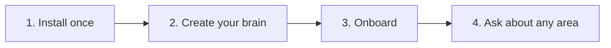

# Copilot Brain

**Your whole company's knowledge (sales, marketing, product, operations, people, finance & legal) in one repo that AI copilots answer from, citing the source file, never inventing.**

[](https://opensource.org/licenses/MIT)
[](https://nodejs.org/)
[](./TECHNICAL.md#3-model-context-protocol-mcp-specification)

[Leer en Español](./README.es.md) · [Technical docs](./TECHNICAL.md)

## See it in 30 seconds

> *Illustrative examples, not recorded sessions. Each answer comes from a sample file in [`templates/areas/`](./templates/areas/).*

```text
Sales rep:  /objection "it's too expensive"
Copilot:    Source: sales/objections/pricing-too-high.json
            Say this: "I completely understand that budget scrutiny is strict right now.
            Let me ask: how much developer time was spent last month refactoring
            hallucinated AI code or tracking down outdated API specs?"
            Next step: a 20-minute ROI review with the engineering velocity calculator.

On-call:    A P1 incident just started. What do I do?
Copilot:    Source: operations/sops/incident-management.json
            1. Acknowledge in PagerDuty within 5 minutes, declare P0/P1, name an Incident Commander.
            2. Communications Lead posts to Statuspage within 15 minutes.
            3. Roll back recent deploys or shed traffic until errors stay below 0.1% for 10 minutes.
            No response in 7 minutes? Escalate to Secondary On-Call.

Account exec: Can I give a 25% discount?
Copilot:    Source: finance_legal/pricing/pricing-tiers-and-discount-matrix.md
            21-30% needs VP of Sales / CRO approval, justified by a public case study,
            logo rights or a joint webinar. Concession: case study & quote within 60 days.
            You can approve up to 10% yourself, with a 12-month prepay.
```

Every answer comes from a file your team owns and reviews. If the file doesn't exist, the copilot says so and offers to create it.

## What lives in each area

| Area | Folders | Example question |
| :--- | :--- | :--- |
| `sales` | `icps/`, `objections/`, `battlecards/`, `scripts/`, `calls/`, `stages/`, `win-loss/` | "How do we beat <competitor>?" |
| `marketing` | `brand/`, `messaging/`, `content/`, `distribution/` | "What is our elevator pitch?" |
| `product` | `roadmap/`, `specs/`, `releases/` | "What are we building this half?" |
| `operations` | `sops/`, `tools/`, `vendors/` | "What do I do when a P1 incident starts?" |
| `hr_people` | `handbook/`, `hiring/`, `onboarding/` | "What does a new hire do in the first 30 days?" |
| `finance_legal` | `pricing/`, `compliance/` | "Who approves a 25% discount?" |

## Quickstart

Requires **Node.js 22+**.

```bash
git clone https://github.com/carlosleoncodepro/clc-copilot-brain.git
cd clc-copilot-brain
npm install
npm link                      # makes `clc-brain` available on your PATH
clc-brain init ../acme-brain  # clean brain by default
```

Open `../acme-brain` in Claude Code or Cursor and run `/brain:onboarding`.

- Explore with sample data first: `clc-brain init ../demo-brain --demo` (remove them later with `clc-brain clean-demo ../demo-brain`).
- Once published to npm, `npm install -g @clc/copilot-brain` will replace the clone + link steps.

## What happens in onboarding

`/brain:onboarding` interviews you one question at a time (company, offer, areas, competitors, objections, owner). Then it:

1. Fills `org-kernel.json` and `company-profile.md`.
2. Drafts the **first real asset for each area you activated**, asking at most one extra question per area:

   | Area | First asset |
   | :--- | :--- |
   | `sales` | An objection card and a battlecard (schema-validated JSON) |
   | `operations` | A first SOP in `operations/sops/` (schema-validated JSON) |
   | `marketing` | `marketing/messaging/core-positioning.md` |
   | `product` | `product/roadmap/q3-q4-product-themes.md` |
   | `hr_people` | `hr_people/handbook/company-handbook.md` |
   | `finance_legal` | `finance_legal/pricing/pricing-tiers-and-discount-matrix.md` |

3. Shows each draft and saves it only after you approve (you can skip any area), then validates with `clc-brain doctor`.

It ends with one example question per seeded area, so you can try **your** data right away.

## Daily use

**Any area: ask in plain language.** *"What is our parental leave?"*, *"Who approves a 25% discount?"*, *"Walk me through our incident SOP."* The copilot searches the brain (see `.agents/skills/brain-search.md`; over MCP, the `brain_query` tool) and cites the file. `/brain` opens the dashboard.

**Sales shortcuts.** Today the dedicated slash commands are sales-focused:

| Command | What it does |
| :--- | :--- |
| `/objection` | Get the approved reply to a buyer objection, or save a new one. |
| `/battlecard` | Compare against a competitor and get your silver bullets. |
| `/call` | Paste a call transcript; it extracts signals and saves it to `sales/calls/YYYY-MM/`. |
| `/flow` | Check pipeline stage rules, or turn a flowchart screenshot into a Mermaid diagram. |
| `/retro` | Monthly retrospective across calls and win/loss reviews (e.g. `/retro 2026-10`). |

See [all slash commands](#all-slash-commands).

## Connect other AI apps

Opening the brain folder in **Claude Code, Cursor, Windsurf or Gemini CLI** needs no setup: `AGENTS.md` holds the rules and `CLAUDE.md`, `GEMINI.md`, `.cursorrules` and `.windsurfrules` point to it.

<details>
<summary>Claude Desktop, Cursor, Zed and other MCP clients</summary>

Add this to your app's MCP config (e.g. `claude_desktop_config.json`) with the absolute path of your brain:

```json
{
  "mcpServers": {
    "copilot-brain": { "command": "clc-brain", "args": ["mcp", "/path/to/acme-brain"] }
  }
}
```

It exposes the tools `brain_query`, `brain_capture_call`, `brain_capture_objection` and `brain_doctor`, plus `call`, `objection`, `battlecard`, `flow` and `retro` as MCP prompts.
</details>

<details>
<summary>ChatGPT, Gemini and Claude on the web</summary>

Inside your brain, follow the copy-paste guides in `skills/integrations/`: `CHATGPT_CUSTOM_GPT.md`, `GEMINI_GEM.md` or `CLAUDE_PROJECT.md`.
</details>

## How it works



Visual walkthrough (Spanish): [docs/diagrams/uso.html](./docs/diagrams/uso.html).

<details>
<summary>Folder guide</summary>

| Path | What goes inside |
| :--- | :--- |
| `company-profile.md`, `org-kernel.json` | Who you are, what you sell, active areas, governance owner. |
| `<area>/` | One folder per active area (see [What lives in each area](#what-lives-in-each-area)). |
| `sales/objections/`, `sales/battlecards/` | Structured JSON (+ Markdown) validated against `schemas/`. |
| `operations/sops/` | Step-by-step procedures, JSON validated against `schemas/sop.schema.json`. |
| `playbooks/` | One operating playbook per area. |
| `schemas/` | JSON Schemas for the kernel, battlecards, objections and SOPs. |

Add a custom area with `clc-brain add-area --custom <id>` or `/brain:add-area`.
</details>

<details>
<summary>Terminal commands</summary>

| Command | What it does |
| :--- | :--- |
| `clc-brain init [dir]` | Create a brain. Clean by default (also with `--yes`); `--demo` adds samples. |
| `clc-brain doctor [dir] [--fix]` | Validate schemas and links; `--fix` applies non-destructive repairs. |
| `clc-brain add-area [dir] --preset <id>` | Add a preset area later (`--custom <id>` for your own). |
| `clc-brain list-areas [dir]` | Show installed vs available areas. |
| `clc-brain clean-demo [dir]` | Remove demo samples, keep your real data. |
| `clc-brain mcp [dir]` | Start the MCP server over stdio. |

Run `clc-brain --help` for every flag.
</details>

<details>
<summary>Migrating existing documents</summary>

- **Text (Notion, Google Docs, handbooks, CRM notes)**: paste it into your copilot and say *"Save this into our brain under operations/sops"* (or any area), or use `/call` for meeting notes. You can also drop `.md` files into the matching folder.
- **Flowcharts (Miro, Lucidchart, whiteboard photos)**: drop the screenshot into the chat and run `/flow` to convert it into a Mermaid diagram in `sales/stages/pipeline-stages.md`.
</details>

### All slash commands

`/objection`, `/battlecard`, `/call`, `/flow`, `/retro`, plus `/brain` (dashboard), `/brain:onboarding` (interview), `/brain:sales` (sales copilot), `/brain:doctor` (health check) and `/brain:add-area` (scaffold areas and assets). Definitions live in `.claude/commands/`.

## Learn more

- [TECHNICAL.md](./TECHNICAL.md): architecture, schemas, MCP protocol, audit guards.
- [docs/Journal/](./docs/Journal/): architecture decision records.
- License: MIT © [Carlos Leon Code Pro](https://github.com/carlosleoncodepro).
