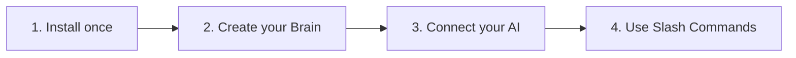

# Copilot Brain 🧠

> **The Living Memory for Your Business & Your AI Assistants.**  
> Keep your sales call notes, buyer objections, competitor battlecards, sales flow diagrams, and company policies in one organized folder — so your AI assistant gives you real, accurate answers instead of guessing.

[](https://opensource.org/licenses/MIT)
[](https://nodejs.org/)
[](./TECHNICAL.md#3-model-context-protocol-mcp-specification)

---

<p align="center">
  <a href="./README.es.md"><strong>🇪🇸 Leer esta guía en Español</strong></a> &bull;
  <a href="./TECHNICAL.md"><strong>🛠️ Technical Architecture & Developer Docs</strong></a>
</p>

---

## Why Copilot Brain?

Every growing team runs into the same three problems:

1. **Important documents get buried**: Notes in Notion, Google Docs, and Slack are written once and forgotten two weeks later.
2. **Every rep answers differently**: One salesperson promises a custom feature or discount; another says it is against company policy.
3. **AI assistants make things up**: When you ask a generic AI to write a sales email or handle an objection, it guesses your pricing and invents features because it does not know your real business rules.

**Copilot Brain** fixes this. It creates a clean, well-organized folder on your computer (or shared team drive) that connects directly to your favorite AI assistant. Whenever you ask a question or type a slash command like `/call` or `/objection`, your AI reads your real company playbook first.

---

## Quick Start (3 Minutes, No Coding Needed)



### Step 1: Install the Tool
Open your computer's terminal (**Terminal** on Mac, or **PowerShell** on Windows) and run:

```bash
npm install -g @clc/copilot-brain
```

### Step 2: Create Your Company Brain
Create a new folder, open it, and run the setup wizard:

```bash
mkdir my-company-brain
cd my-company-brain
clc-brain init
```

The assistant will ask 4 simple questions:
1. **Company Name** (e.g., *Acme Corp*)
2. **Industry** (e.g., *B2B Software & Automation*)
3. **Main Value Proposition / Tagline**
4. **Departments to Include** (Sales, Marketing, Product, Operations, HR, Finance) and whether you want a **Clean Repository** (recommended for real use) or **Demo Samples**.

---

## What Goes Where? (Folder Guide)

You never have to guess where to save a file. You can either drop files directly into these folders, or paste your text in the chat and tell your AI assistant to save it for you:

| Folder or File | What Goes Inside | Everyday Examples |
| :--- | :--- | :--- |
| **`company-profile.md`** | Your core business summary | What you sell, who you sell to, and your main value proposition. |
| **`sales/calls/`** | Meeting notes & call transcripts | Zoom/Meet transcripts, discovery call notes, and customer feedback organized by month (`YYYY-MM`). |
| **`sales/objections/`** | Responses to buyer pushback | Approved scripts for *"It's too expensive"*, *"We already use Competitor X"*, or *"Send me info next quarter"*. |
| **`sales/battlecards/`** | Competitor comparisons | Side-by-side sheets showing why you win against specific competitors and what questions expose their weaknesses. |
| **`sales/stages/`** | **Sales flows & pipeline rules** | Your visual sales process diagram (Mermaid flowcharts) and what must happen before a deal moves to the next stage. |
| **`sales/icps/`** | Ideal customer profiles | Who your best buyers are (job titles, pain points, budget triggers, and red flags). |
| **`operations/sops/`** | Step-by-step team checklists | How to onboard a new client, how to handle a support escalation, or internal processes. |

---

## How to Migrate Your Existing Documents & Visual Sales Flows

Already have material in **Notion, Google Docs, Word, PDFs, Miro, or Lucidchart**? Moving it into your Second Brain takes seconds:

### 1. Migrating Written Documents (Notion, Google Docs, CRM Notes)
- **Option A (Let the AI format it for you)**: Copy the text from your old document, paste it into your AI chat, and say:
  > *"Save this pricing objection into our Second Brain."* or *"Use `/call` to analyze and save these meeting notes."*
- **Option B (Drag and Drop)**: Save your notes as Markdown (`.md`) or text files and drop them directly into the matching folder (such as `sales/scripts/` or `operations/sops/`).

### 2. Migrating Visual Flowcharts (Screenshots, Miro, Lucidchart, Whiteboards)
Do you have a visual diagram of your sales pipeline or customer journey as an image, PDF, or screenshot?
1. **Take a screenshot** of your flowchart (from Miro, Lucidchart, Figma, slides, or a whiteboard photo).
2. **Drag and drop the image** directly into your AI assistant chat.
3. **Type `/flow` or tell the AI**:
   > *"Convert this screenshot of our sales flow into an interactive Mermaid diagram inside `sales/stages/pipeline-stages.md`."*

Your AI will translate the picture into a clean, editable visual diagram right inside your repository that any team member or AI can read and update anytime.

---

## Instant Slash Commands Reference

Once connected, you don't need to write long instructions. Just type a slash command in your AI chat:

| Slash Command | What It Does | Example Usage |
| :--- | :--- | :--- |
| **`/call`** | **Save and analyze a meeting or call transcript.** Extracts deal signals, objections, and action items into `sales/calls/`. | `/call` + paste your Zoom transcript or rough call notes. |
| **`/objection`** | **Get an instant answer to a buyer objection** or save a new one into `sales/objections/`. | `/objection Prospect says our onboarding takes too long.` |
| **`/battlecard`** | **Compare against a competitor in seconds** using `sales/battlecards/`. | `/battlecard How do we beat Competitor Alpha on security?` |
| **`/flow`** | **Check pipeline stage rules or update your sales flow diagram** in `sales/stages/pipeline-stages.md`. | `/flow What is required to move a deal from Discovery to Validation?` |
| **`/retro`** | **Run your monthly sales retrospective.** Summarizes win/loss trends and top objections across all calls in a month. | `/retro 2026-10` |
| **`/brain`** | **Open the main Second Brain dashboard** to see active departments and quick actions. | `/brain` |
| **`/brain:onboarding`** | **Run the guided company interview** (1 question at a time) to fill out your company profile. | `/brain:onboarding` |
| **`/brain:doctor`** | **Check your Second Brain health** and fix any missing files or formatting issues. | `/brain:doctor` |

---

## Works Everywhere (Universal AI Compatibility)

Copilot Brain is built on open standards. You are never locked into a single AI vendor:

### 1. AI Desktop & Coding Apps (via Model Context Protocol — MCP)
Works natively with **Claude Desktop, Cursor, OpenAI Codex, Google Antigravity, Windsurf, Zed, and Gentle Dot**.
Add this block to your app's MCP configuration file (for example, `claude_desktop_config.json`):

```json
{
  "mcpServers": {
    "copilot-brain": {
      "command": "clc-brain",
      "args": ["mcp", "/full/path/to/my-company-brain"]
    }
  }
}
```
*(Replace `/full/path/to/my-company-brain` with the actual folder path on your computer. Both MCP tools and MCP slash prompts are automatically enabled!)*

### 2. Workspace AI Assistants (Automatic Rule Mirrors)
If you open your brain folder directly inside **Claude Code, Cursor, Windsurf, or Gemini CLI**, it works immediately with zero configuration:
- `AGENTS.md` acts as the master instruction manual.
- `CLAUDE.md`, `GEMINI.md`, `.cursorrules`, and `.windsurfrules` automatically point to `AGENTS.md`.
- `.claude/commands/` provides all slash commands (`/call`, `/objection`, `/battlecard`, `/flow`, `/retro`, `/brain`).

### 3. Web AI Chatbots (ChatGPT Plus/Team & Google Gemini Web)
Prefer using ChatGPT or Google Gemini in your web browser?
- Open the **`skills/integrations/`** folder inside your Second Brain.
- Follow the 2-minute copy-paste guides in `chatgpt-custom-gpt.md` or `gemini-gem.md` to create a Custom GPT or Gemini Gem powered by your Second Brain files.

---

## Helpful Terminal Commands

- **`clc-brain init`** — Create a new Second Brain (choose Clean mode or Demo mode).
- **`clc-brain clean-demo`** — Remove sample demo files anytime and keep only your real company files.
- **`clc-brain add-area`** — Add a new department folder later (e.g., Product, HR, or Finance).
- **`clc-brain list-areas`** — See which departments are active.
- **`clc-brain doctor`** — Check repository health and automatically repair missing adapters (`--fix`).

---

## Technical Documentation

Are you a developer or system administrator looking for JSON Schema contracts, MCP wire protocol details (`tools/list`, `tools/call`, `prompts/list`, `prompts/get`), or AST audit guards?
👉 **[Read the Technical Architecture Guide (TECHNICAL.md)](./TECHNICAL.md)**

---

## License

MIT License © [Carlos Leon Code Pro](https://github.com/carlosleoncodepro). Free for personal, commercial, and enterprise use.
