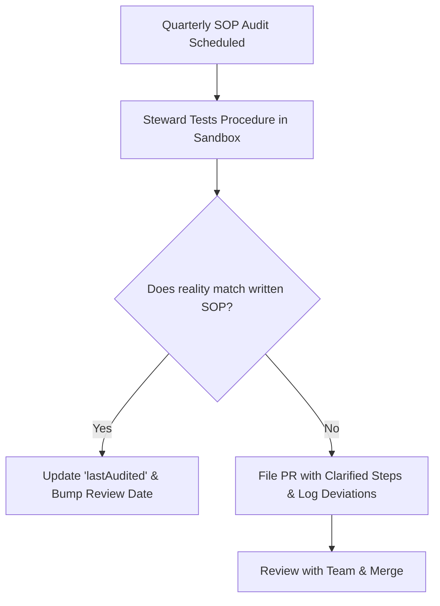

# Operations Governance & SOP Playbook

## 1. Objectives

Operations is the execution backbone. It ensures business continuity, tool stewardship, vendor accountability, and standard operating procedure (SOP) rigor.

```
operations/
├── sops/       # Standard operating procedures (step-by-step checklists, JSON + MD)
├── tools/      # Internal tool directory, owners, licenses, access procedures
└── vendors/    # Third-party providers, contact points, SLAs, renew dates
```

---

## 2. Standard Operating Procedure (SOP) Standard

All SOPs must validate against `schemas/sop.schema.json`.

### Non-Negotiable SOP Structure:
- **Unique ID**: Lowercase kebab-case (e.g., `sop-incident-management`)
- **Owner**: Specific named role or individual responsible for currency
- **Effective Date & Review Frequency**: Typically audited every 6 months
- **Prerequisites & Tool Requirements**: Permissions or tokens required before starting
- **Numbered Steps**: Atomic, clear instructions with responsible roles, expected outputs, and escalation triggers
- **Verification Checklist**: Concrete checklist items confirming completion

---

## 3. SOP Audit Lifecycle



---

## 4. Emergency Response Protocols (P0 / P1 Incidents)

When critical systems fail:
1. **Declare Incident**: Appoint Incident Commander (IC), Communications Lead, and Operations Lead.
2. **Execute Incident SOP**: Reference `operations/sops/incident-management.md`.
3. **Dedicated Channel**: Spin up isolated incident war room; log timestamps and remediation actions.
4. **Post-Mortem**: Within 48 hours, conduct blameless retrospective and commit learnings to brain.
