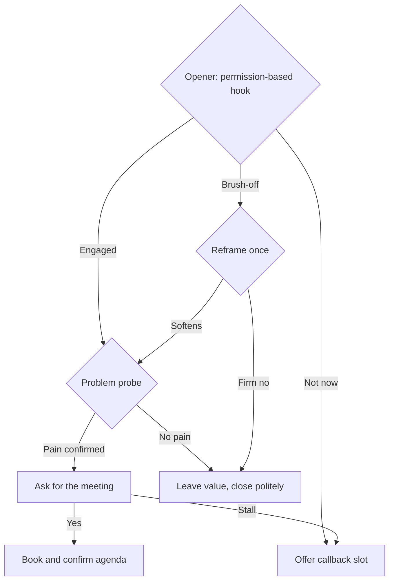

# Play: Cold Call

> **Goal:** earn a 25-minute discovery meeting. Do not pitch, qualify lightly, and ask for the meeting.
> **Stage:** 1 (entry). **Related:** [discovery-call](./discovery-call.md), [cold outreach frameworks](../scripts/cold-outreach-email.md).

## Decision Tree

## Branches

| Branch | Trigger | Talk track | Script link |
| :--- | :--- | :--- | :--- |
| B1 | Prospect picks up | "Did I catch you at a bad time? I will be brief and you can tell me to go away." | [Cold outreach](../scripts/cold-outreach-email.md) |
| B2 | Prospect stays on the line | Ask one problem question tied to the prospect's role. | [Cold outreach](../scripts/cold-outreach-email.md) |
| B3 | "Not now" or stall | "Totally fair. Would Thursday morning or Friday afternoon work for five minutes?" | [Cold outreach](../scripts/cold-outreach-email.md) |
| B4 | "Send me an email" | Reframe once: "Happy to. So I send the right thing, what is the one issue you would want it to cover?" | [Cold outreach](../scripts/cold-outreach-email.md) |
| B5 | Pain confirmed | "Based on that, a 25-minute conversation would show if we can help. Does next week work?" | [Discovery framework](../scripts/discovery-call-framework.md) |
| B6 | No pain or firm no | Thank them, leave one useful resource, log the call. | [Cold outreach](../scripts/cold-outreach-email.md) |
| B7 | Meeting accepted | Confirm date, attendees, and agenda in writing. | [Discovery framework](../scripts/discovery-call-framework.md) |

## Learnings Log

<!-- Format: - YYYY-MM-DD vN->vN+1: change (evidence: CALL-...) -->
- No entries yet. `/retro` proposes edits here after enough logged calls.
