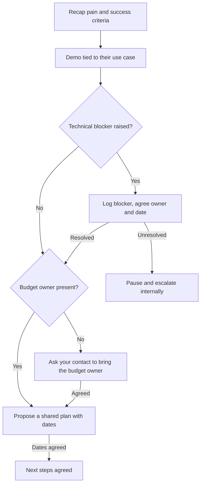

# Play: Demo Call

> **Goal:** show the prospect's own problem solved, get technical sign-off, and agree a mutual action plan.
> **Stage:** 2. **Gate:** Gate 2 in [pipeline-stages](../stages/pipeline-stages.md). **Related:** [discovery-call](./discovery-call.md), [follow-up](./follow-up.md).

## Decision Tree

## Branches

| Branch | Trigger | Talk track | Script link |
| :--- | :--- | :--- | :--- |
| B1 | Demo starts | "Last time you told us about [pain]. Let me show exactly how that changes. Did I get your priorities right?" | — |
| B2 | Pain confirmed | Show only the workflow tied to their pain; skip unrelated features. | — |
| B3 | Prospect asks a technical question | Answer from verified material only; never invent features. | — |
| B4 | No blockers | "Who else should see this before a decision?" | — |
| B5 | Blocker raised | "What would you need to see to be comfortable? Who owns that and by when?" | — |
| B6 | Budget owner engaged | Propose a shared plan with dates, working back from the day they want to decide. | — |
| B7 | Blocker unresolved | Pause new work, log the reason, escalate internally. | — |
| B8 | Budget owner not on the call | "Could you bring the budget owner to a 20-minute session?" | — |
| B9 | Plan agreed | Note in the call log that the deal moved forward. | — |

## Learnings Log

<!-- Format: - YYYY-MM-DD vN->vN+1: change (evidence: CALL-...) -->
- No entries yet. `/retro` proposes edits here after enough logged calls.
