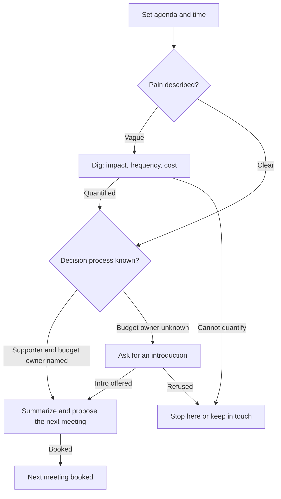

# Play: Discovery Call

> **Goal:** confirm ICP fit, quantify the pain, find the champion and economic buyer, and book the validation meeting.
> **Stage:** 1. **Gate:** Gate 1 in [pipeline-stages](../stages/pipeline-stages.md). **Related:** [cold-call](./cold-call.md).

## Decision Tree

## Branches

| Branch | Trigger | Talk track | Script link |
| :--- | :--- | :--- | :--- |
| B1 | Call starts | "The goal is to understand how you work today and decide together if a next step makes sense. Fair?" | [Discovery framework](../scripts/discovery-call-framework.md) |
| B2 | Prospect describes a problem | Mirror it back in one sentence and ask what it costs. | [Discovery framework](../scripts/discovery-call-framework.md) |
| B3 | Answers stay vague | "If this stays as is for a year, what does that cost you in hours or revenue?" | [Discovery framework](../scripts/discovery-call-framework.md) |
| B4 | Pain is clear | "Who else would need to agree to fix this, and how are decisions like this made?" | [Discovery framework](../scripts/discovery-call-framework.md) |
| B5 | Supporter and budget owner named | Summarize pain, impact, and owners; propose a validation meeting with an agenda. | [Discovery framework](../scripts/discovery-call-framework.md) |
| B6 | Budget owner unknown | "Who holds the budget for this? Could you introduce us?" | [Discovery framework](../scripts/discovery-call-framework.md) |
| B7 | No quantified pain or access | Close the loop politely, log the reason, and keep in touch from time to time. | [Discovery framework](../scripts/discovery-call-framework.md) |
| B8 | Meeting booked | Note in the call log that the deal moved forward. | [Discovery framework](../scripts/discovery-call-framework.md) |

## Learnings Log

<!-- Format: - YYYY-MM-DD vN->vN+1: change (evidence: CALL-...) -->
- No entries yet. `/retro` proposes edits here after enough logged calls.
