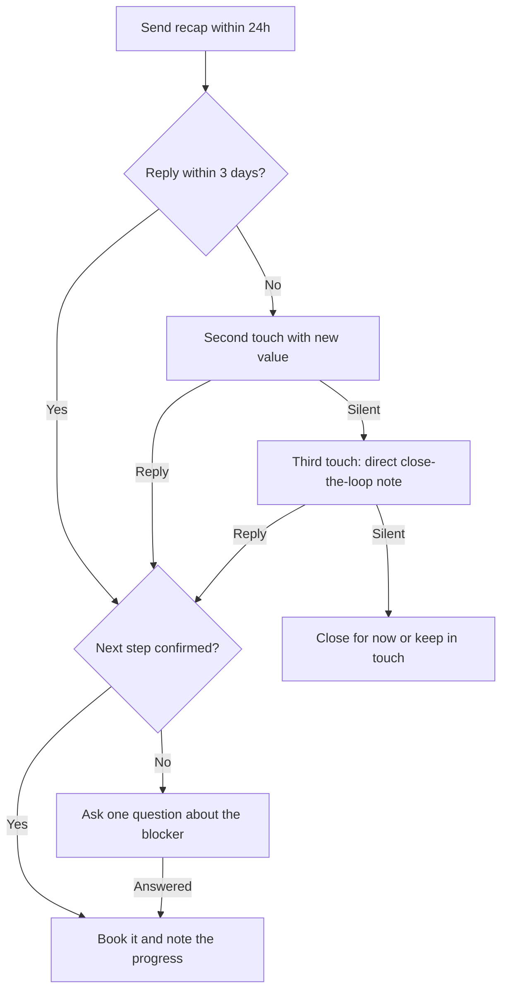

# Play: Follow-up

> **Goal:** after any meeting, send a short recap, confirm the next step, and re-engage quiet deals without pressure.
> **Stages:** 2, 3, 4. **Gates:** see [pipeline-stages](../stages/pipeline-stages.md). **Related:** [demo-call](./demo-call.md).

## Decision Tree

## Branches

| Branch | Trigger | Talk track | Script link |
| :--- | :--- | :--- | :--- |
| B1 | Meeting just ended | Recap decisions, owners, and the agreed next step in five lines or fewer. | — |
| B2 | Waiting for reply | Wait 3 business days before the next touch. | — |
| B3 | Prospect replied | Confirm the next step, owner, and date in writing. | — |
| B4 | No reply | Add one new piece of value (case study, answer to an open question), not a nudge. | — |
| B5 | Step confirmed | Book the meeting, update the call log, and note that the deal moved forward. | — |
| B6 | Reply without commitment | "What would need to be true for this to move forward?" | — |
| B7 | Still silent | "Should I close this out for now, or is the timing just off?" | — |
| B8 | No response to the close-the-loop note | Close it for now or keep in touch from time to time, and log the reason. | — |

## Learnings Log

<!-- Format: - YYYY-MM-DD vN->vN+1: change (evidence: CALL-...) -->
- No entries yet. `/retro` proposes edits here after enough logged calls.
