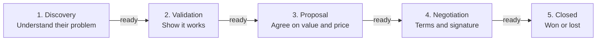

# Sales Pipeline Stages & Gate Criteria (`sales/stages/`)

> **Operating Standard:** A deal moves to the next stage only when every exit criterion of its current stage is met and noted in the repository. This keeps the forecast honest.

---

## 1. Pipeline Stage Progression Overview

---

## 2. Stage Definitions & Gate Exit Criteria

### Stage 1: Discovery
- **Probability Weight**: 10%
- **Target Cycle Duration**: 10 – 14 calendar days
- **Objective**: Check that the prospect fits our ideal customer profile, understand the problem and what it costs them, and find out who decides.
- **Key Activities**:
  - Run the discovery call using `sales/scripts/discovery-call-framework.md`.
  - Log the call in `sales/calls/YYYY-MM/` using `skill_call_analyzer.md`.
  - Check the deal against `sales/qualification/qualification-matrix.md`.
- **Gate 1 Exit Criteria (all required to move to Stage 2)**:
  - [ ] **Problem understood**: The prospect described the problem and what it costs them (time, money, or missed opportunities).
  - [ ] **Good fit**: The company matches our ideal customer profile in `sales/icps/`.
  - [ ] **Supporter found**: At least one person on their side wants the problem solved and will help us.
  - [ ] **Decision maker identified**: Name and role of the person who approves the budget.
  - [ ] **Next meeting booked**: A follow-up meeting is on the calendar with a clear agenda.

---

### Stage 2: Validation
- **Probability Weight**: 30%
- **Target Cycle Duration**: 14 – 21 calendar days
- **Objective**: Show that our offer solves their problem and meet the decision maker.
- **Key Activities**:
  - Run a demo or trial built around their own situation.
  - Answer comparisons with competitors using `sales/battlecards/`.
  - Share relevant customer stories from `sales/case-studies/`.
- **Gate 2 Exit Criteria (all required to move to Stage 3)**:
  - [ ] **Fit confirmed**: The prospect agrees our offer solves their problem, with no open blockers.
  - [ ] **Decision maker met**: We spoke directly with the person who approves the budget.
  - [ ] **What matters to them is clear**: We know how they will choose, and our strengths are on that list.
  - [ ] **Shared plan agreed**: Both sides agreed on the next steps and a target decision date.

---

### Stage 3: Proposal
- **Probability Weight**: 60%
- **Target Cycle Duration**: 14 – 20 calendar days
- **Objective**: Agree on the value and the price, and send a written proposal.
- **Key Activities**:
  - Present the value for them (what they save or gain) to the decision maker.
  - Handle price concerns using `sales/objections/pricing-too-high.md`.
  - Bring in everyone who must approve the purchase (finance, legal, purchasing).
- **Gate 3 Exit Criteria (all required to move to Stage 4)**:
  - [ ] **Budget confirmed**: The decision maker agrees the value is worth it and the budget is available.
  - [ ] **Proposal sent**: Scope, price, and options are delivered in writing.
  - [ ] **We are the choice**: The prospect says we are their preferred option.

---

### Stage 4: Negotiation
- **Probability Weight**: 85%
- **Target Cycle Duration**: 14 – 30 calendar days
- **Objective**: Agree on the final terms and get the contract signed.
- **Key Activities**:
  - Work through contract changes with their legal or purchasing team.
  - Answer any approval checks they need before buying (for example security or compliance questions).
  - Agree on payment terms and the signing steps.
- **Gate 4 Exit Criteria (all required to move to Stage 5)**:
  - [ ] **Approvals done**: Every internal approval the prospect needs is granted.
  - [ ] **Terms agreed**: Both sides accept the contract terms.
  - [ ] **Contract sent for signature**: The final contract is with the person authorized to sign.

---

### Stage 5: Closed (Won or Lost)
- **Closed Won (100%)**:
  - Contract signed by both sides.
  - Kickoff meeting booked with the team that will serve the customer.
  - Win review saved in `sales/win-loss/` within 5 business days.
- **Closed Lost (0%)**:
  - The deal was lost, cancelled, or went to a competitor.
  - Main reason recorded (missing feature, competitor, no budget, lost our supporter, other).
  - Loss review saved in `sales/win-loss/` within 5 business days.

---

## 3. Stage Velocity & Stuck-Deal Alerts

| Stage | Normal Duration | Warning Sign | What to Do |
| :--- | :--- | :--- | :--- |
| **Stage 1: Discovery** | 10 days | > 21 days with no second meeting | Ask directly whether this is still a priority, or close it for now. |
| **Stage 2: Validation** | 18 days | > 35 days without meeting the decision maker | Ask your supporter for an introduction; pause extra effort until it happens. |
| **Stage 3: Proposal** | 15 days | > 30 days without an answer to the proposal | Recheck the problem and the budget with your supporter. |
| **Stage 4: Negotiation** | 20 days | > 45 days in approvals or contract review | Ask a senior leader on our side to call their decision maker. |

---

## 4. Visual Journey Mapping via Archify

Per `org-kernel.json` -> `ecosystemTools.salesFlowDiagrams`, the team can keep richer journey maps with **Archify** (`https://github.com/tt-a1i/archify`). This is optional: the sales system page already draws this pipeline and every call guide without internet.

When the monthly retrospective (`skill_monthly_retrospective.md`) finds a stage where deals keep getting stuck, update this file (and the journey map, if you use one) to add or reorder steps.
