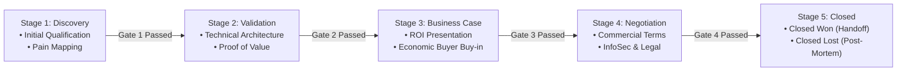

# Canonical Sales Pipeline Stages & Gate Criteria (`sales/stages/`)

> **Operating Standard:** Pipeline integrity is the bedrock of predictable revenue forecasting. An opportunity **cannot advance** to the next stage unless every mandatory exit criterion has been validated and documented in the repository.

---

## 1. Pipeline Stage Progression Overview

---

## 2. Stage Definitions & Mandatory Gate Exit Criteria

### Stage 1: Discovery & Initial Qualification
- **Probability Weight**: 10%
- **Target Cycle Duration**: 10 – 14 calendar days
- **Objective**: Determine whether the prospect matches our ICP, uncover quantified operational pain, and identify potential Champions.
- **Key Activities**:
  - Run initial discovery call using `sales/scripts/discovery-call-framework.md`.
  - Log call intelligence into `sales/calls/YYYY-MM/` using `skill_call_analyzer.md`.
  - Evaluate opportunity against `sales/qualification/qualification-matrix.md`.
- **Mandatory Gate 1 Exit Criteria (Must satisfy all to advance to Stage 2)**:
  - [ ] **Quantified Pain**: Documented business problem costing verifiable engineering hours or revenue.
  - [ ] **ICP Match**: Company profile aligns with enterprise/mid-market developer organization criteria.
  - [ ] **Identified Champion**: At least one engineering leader (Director, VP, or Lead Architect) committed to resolving the pain.
  - [ ] **Economic Buyer Identified**: Name and title of the budget holder confirmed.
  - [ ] **Scheduled Validation Meeting**: Technical deep dive booked on calendar with clear agenda.

---

### Stage 2: Technical Validation & Architecture Fit
- **Probability Weight**: 30%
- **Target Cycle Duration**: 14 – 21 calendar days
- **Objective**: Prove architectural compatibility, demonstrate developer productivity workflows, and validate security compliance.
- **Key Activities**:
  - Conduct hands-on technical demonstration with architecture/platform leads.
  - Demonstrate Git-native storage, local CLI validation (`copilot-brain doctor`), and IDE rules generation (`.cursorrules`, `CLAUDE.md`, `.windsurfrules`).
  - Deploy counter-arguments against competitors using `sales/battlecards/`.
  - Share case study proof points from `sales/case-studies/`.
- **Mandatory Gate 2 Exit Criteria (Must satisfy all to advance to Stage 3)**:
  - [ ] **Technical Architecture Sign-off**: Platform Architect or Lead Engineer confirms technical feasibility and zero blocker objections.
  - [ ] **Economic Buyer Meeting Completed**: Direct conversation held with the confirmed Economic Buyer.
  - [ ] **Decision Criteria Influenced**: Prospect's evaluation scorecard reflects our core differentiators (GitOps, Markdown SSOT, zero vendor lock-in).
  - [ ] **Mutual Action Plan (MAP) Initiated**: Joint timeline agreed upon leading to a target decision date.

---

### Stage 3: Business Case & Economic Buyer Alignment
- **Probability Weight**: 60%
- **Target Cycle Duration**: 14 – 20 calendar days
- **Objective**: Align executive leadership on financial ROI, secure budget allocation, and finalize the commercial package.
- **Key Activities**:
  - Present tailored Business Case & ROI Payback model to the Economic Buyer and finance leadership.
  - Handle commercial or pricing objections using `sales/objections/pricing-too-high.md`.
  - Multi-thread across procurement, legal, and security contacts.
  - Issue preliminary Master Services Agreement (MSA) and Order Form draft.
- **Mandatory Gate 3 Exit Criteria (Must satisfy all to advance to Stage 4)**:
  - [ ] **Formal Business Case Approved**: Economic Buyer explicitly validates ROI model and confirms budget availability.
  - [ ] **Commercial Proposal Submitted**: Contract scope, user tiers, ARR, and multi-year options delivered in writing.
  - [ ] **Vendor Selection Confirmed**: Prospect explicitly selects our solution as the preferred vendor over competitors.
  - [ ] **InfoSec / Compliance Initiation**: Security review packet (SOC2 / architecture briefs) submitted to customer security team.

---

### Stage 4: Negotiation, InfoSec & Procurement
- **Probability Weight**: 85%
- **Target Cycle Duration**: 14 – 30 calendar days
- **Objective**: Execute legal redlines, pass InfoSec vendor assessment, finalize procurement onboarding, and secure signature.
- **Key Activities**:
  - Coordinate legal counsel redlines on terms of service, SLA, and data protection agreements.
  - Answer InfoSec vendor risk assessments and compliance questionnaires.
  - Finalize billing terms (quarterly/annual upfront) and signoff workflow.
- **Mandatory Gate 4 Exit Criteria (Must satisfy all to advance to Stage 5)**:
  - [ ] **InfoSec Clearance**: Formal security and compliance approval granted in writing.
  - [ ] **Legal Terms Agreed**: All MSA redlines resolved by both legal counsels.
  - [ ] **Signer Verified**: Final executable contract sent via DocuSign to authorized signatory.

---

### Stage 5: Closed (Won or Lost)
- **Closed Won (100%)**:
  - Executable contract signed by both parties.
  - Kickoff meeting scheduled with Customer Success / Solutions Engineering.
  - Deal win post-mortem committed to `sales/win-loss/` within 5 business days.
- **Closed Lost (0%)**:
  - Opportunity disqualified, cancelled, or won by competitor.
  - Clear loss reason categorized (Product Gap, Competitor Displacement, Budget Freeze, Champion Loss).
  - Closed Lost post-mortem committed to `sales/win-loss/` within 5 business days.

---

## 3. Stage Velocity & Chokepoint SLA Alerts

| Stage | Normal Duration | Chokepoint Warning Trigger | Required Remediation Action |
| :--- | :--- | :--- | :--- |
| **Stage 1: Discovery** | 10 days | > 21 days with no second call | Send Disqualification Script C or archive opportunity. |
| **Stage 2: Validation** | 18 days | > 35 days without EB access | Execute Disqualification Script A; pause technical resources. |
| **Stage 3: Business Case** | 15 days | > 30 days without commercial proposal sign-off | Re-examine Identified Pain with Champion; verify budget vitality. |
| **Stage 4: Negotiation** | 20 days | > 45 days in InfoSec/Legal | Request executive sponsor intervention call between CRO/CEO and prospect CIO. |

---

## 4. Visual Journey Mapping via Archify

Per `org-kernel.json` -> `ecosystemTools.salesFlowDiagrams`, sales engineers and RevOps maintain interactive sequence, lifecycle, and journey maps using **Archify** (`https://github.com/tt-a1i/archify`). 

Whenever a recurring chokepoint or friction pattern is detected during the monthly retrospective (`skill_monthly_retrospective.md`), the Archify sales journey diagram must be adjusted to re-sequence gates or introduce pre-qualification steps.
