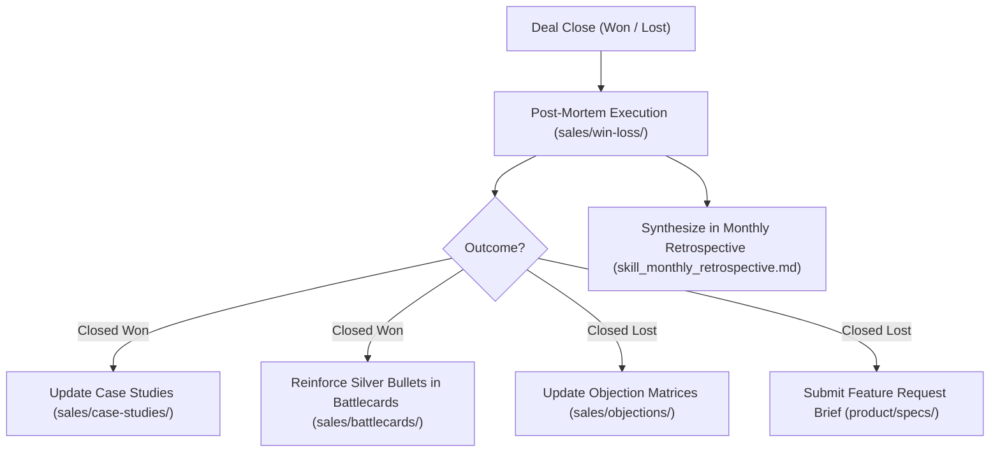

# Win / Loss Post-Mortem Process (`sales/win-loss/`)

Welcome to the **Win / Loss Post-Mortem Hub**. In high-velocity B2B sales organizations, closed deals (both won and lost) contain the highest-fidelity market intelligence available.

---

## 1. Objective & Philosophy

- **Wins are not accidents**: We reverse-engineer why customers chose us over competitors and internal inertia to institutionalize repeatability across the entire revenue organization.
- **Losses are tuition**: We rigorously dissect why deals failed—not to assign blame, but to update objection matrices, enhance battlecards, refine qualification gates, or feed architectural gaps to Product.
- **Radical Candor**: Post-mortems require intellectual honesty. Blaming "price" or "they didn't have budget" is forbidden without validating the underlying root causes.

---

## 2. Post-Mortem Cadence & Responsibilities

| Deal Tier | ARR Threshold | Process Cadence | Required Participants | Deliverable |
| :--- | :--- | :--- | :--- | :--- |
| **Tier 1 (Enterprise)** | > $100k ARR | Within 5 business days of deal close | AE, Sales Lead, Product Specialist, Solutions Architect | Formal Post-Mortem Document in `sales/win-loss/` |
| **Tier 2 (Mid-Market)** | $25k – $100k ARR | Within 7 business days of deal close | AE, Sales Lead | Async Post-Mortem Document in `sales/win-loss/` |
| **Tier 3 (Velocity)** | < $25k ARR | Monthly batch review | RevOps / Lead AE | Summary in Monthly Retro (`skill_monthly_retrospective.md`) |

---

## 3. The 4 Analytical Dimensions

Every post-mortem analyzes the deal through four mandatory dimensions:
1. **Core Decision Driver**: The primary catalyst, business crisis, or technical advantage that decided the outcome.
2. **Pricing Impact**: Perceived Total Cost of Ownership (TCO), discounting dynamics, packaging structure, and budget authorization friction.
3. **Competitor Impact**: Which competitors, legacy platforms, or internal build alternatives were considered, and where our positioning held or cracked.
4. **Process & Qualification Learnings**: Adherence to MEDDPICC, champion strength, sales cycle speed, and handoff quality.

---

## 4. Closed-Loop Repository Feedback Loop

A post-mortem is only complete when its learnings feed back into repository assets:

---

## 5. File Inventory
- [`post-mortem-template.md`](./post-mortem-template.md): Canonical 4-dimension template for logging new reviews.
- [`sample-closed-won-fintech.md`](./sample-closed-won-fintech.md): Reference analysis of a $180k ARR enterprise win.
- [`sample-closed-lost-legacy.md`](./sample-closed-lost-legacy.md): Reference analysis of a $140k ARR enterprise loss with competitor displacement insights.
