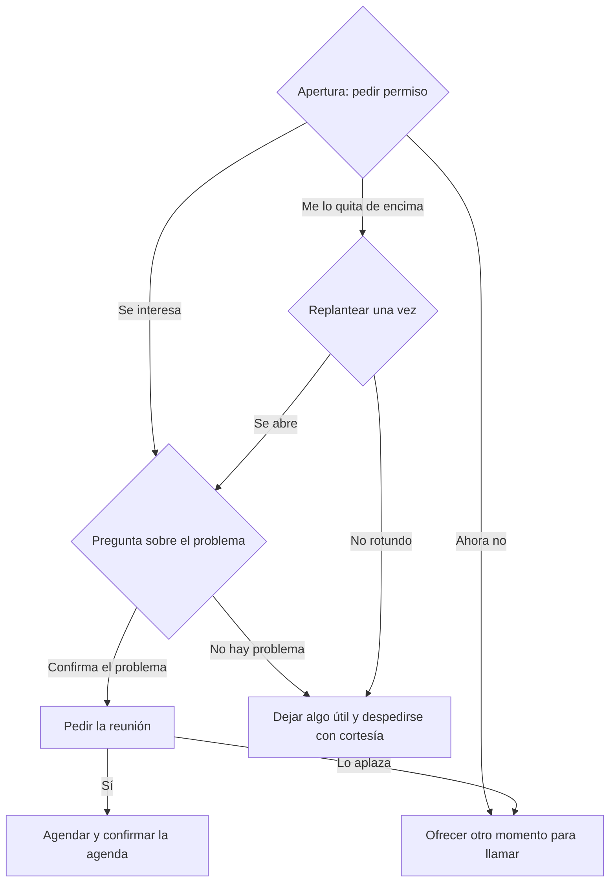

# Guía: Llamada en frío

> **Objetivo:** conseguir una reunión de descubrimiento de 25 minutos. No presentes el producto, califica con suavidad y pide la reunión.
> **Etapa:** 1 (entrada). **Relacionadas:** [discovery-call](./discovery-call.md).

## Árbol de decisiones

## Situaciones

| Situación | Cuándo pasa | Qué decir | Guion |
| :--- | :--- | :--- | :--- |
| B1 | El cliente contesta | "¿Te llamo en mal momento? Seré breve y, si no te interesa, me lo dices." | — |
| B2 | El cliente sigue en la llamada | Haz una sola pregunta sobre el problema, ligada a su cargo. | — |
| B3 | "Ahora no" o lo aplaza | "Lo entiendo. ¿Te va mejor el jueves por la mañana o el viernes por la tarde, cinco minutos?" | — |
| B4 | "Mándame un correo" | Replantea una vez: "Con gusto. Para enviarte lo correcto, ¿qué tema te gustaría que tratara?" | — |
| B5 | Confirma el problema | "Por lo que me cuentas, en una conversación de 25 minutos veríamos si podemos ayudarte. ¿Te va bien la próxima semana?" | — |
| B6 | No hay problema o es un no rotundo | Agradece, deja un recurso útil y registra la llamada. | — |
| B7 | Acepta la reunión | Confirma por escrito la fecha, los asistentes y la agenda. | — |

## Registro de aprendizajes

<!-- Formato: - YYYY-MM-DD vN->vN+1: cambio (evidencia: CALL-...) -->
- Todavía no hay entradas. `/retro` propone cambios aquí cuando haya suficientes llamadas registradas.
