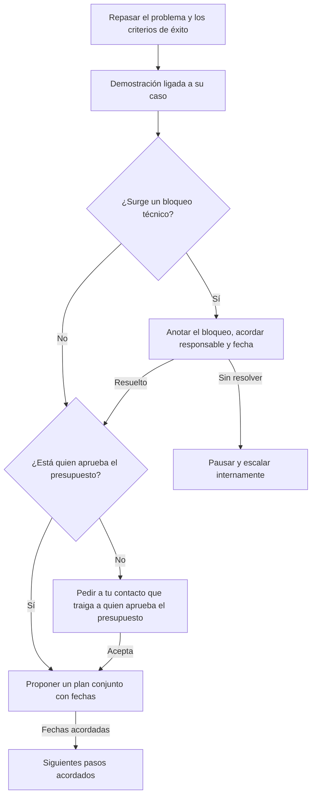

# Guía: Llamada de demostración

> **Objetivo:** mostrar resuelto el problema del propio cliente, obtener el visto bueno técnico y acordar un plan de acción conjunto.
> **Etapa:** 2. **Puerta:** Puerta 2 en [pipeline-stages](../stages/pipeline-stages.md). **Relacionadas:** [discovery-call](./discovery-call.md), [follow-up](./follow-up.md).

## Árbol de decisiones

## Situaciones

| Situación | Cuándo pasa | Qué decir | Guion |
| :--- | :--- | :--- | :--- |
| B1 | Empieza la demostración | "La última vez nos contaste sobre [problema]. Te muestro exactamente cómo cambia eso. ¿Entendí bien sus prioridades?" | — |
| B2 | Confirma el problema | Muestra solo el flujo ligado a su problema; omite las funciones que no tienen relación. | — |
| B3 | El cliente hace una pregunta técnica | Responde solo con material verificado; nunca inventes funciones. | — |
| B4 | No hay bloqueos | "¿Quién más debería ver esto antes de tomar una decisión?" | — |
| B5 | Surge un bloqueo | "¿Qué necesitarías ver para quedarte tranquilo? ¿Quién se encarga y para cuándo?" | — |
| B6 | Quien aprueba el presupuesto participa | Propón un plan conjunto con fechas, contando hacia atrás desde el día en que quieren decidir. | — |
| B7 | El bloqueo sigue sin resolverse | Pausa el trabajo nuevo, registra el motivo y escala internamente. | — |
| B8 | Quien aprueba el presupuesto no está en la llamada | "¿Podrías traer a la persona que aprueba el presupuesto a una sesión de 20 minutos?" | — |
| B9 | Plan acordado | Anota en el registro de la llamada que el negocio avanzó. | — |

## Registro de aprendizajes

<!-- Formato: - YYYY-MM-DD vN->vN+1: cambio (evidencia: CALL-...) -->
- Todavía no hay entradas. `/retro` propone cambios aquí cuando haya suficientes llamadas registradas.
