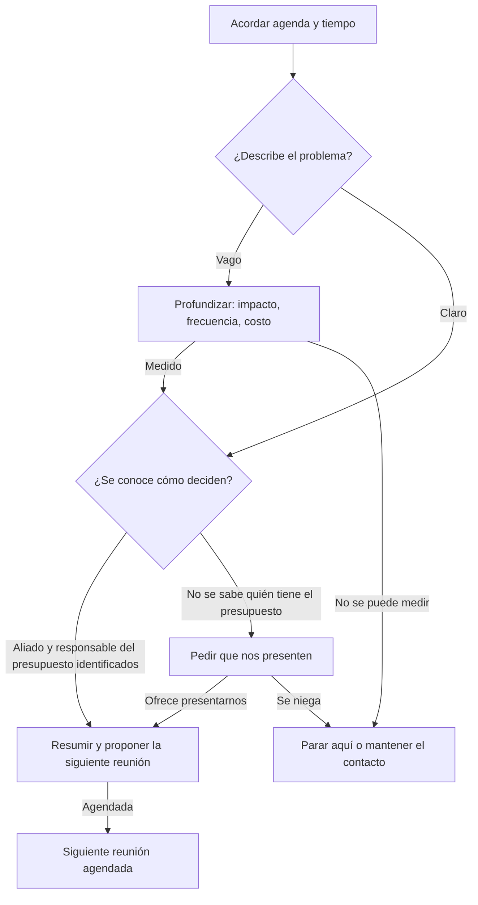

# Guía: Llamada de descubrimiento

> **Objetivo:** confirmar que encaja con nuestro cliente ideal, medir el problema, encontrar al aliado y a la persona que aprueba el presupuesto, y agendar la reunión de validación.
> **Etapa:** 1. **Puerta:** Puerta 1 en [pipeline-stages](../stages/pipeline-stages.md). **Relacionadas:** [cold-call](./cold-call.md).

## Árbol de decisiones

## Situaciones

| Situación | Cuándo pasa | Qué decir | Guion |
| :--- | :--- | :--- | :--- |
| B1 | Empieza la llamada | "La idea es entender cómo trabajan hoy y decidir juntos si tiene sentido un siguiente paso. ¿Te parece bien?" | — |
| B2 | El cliente describe un problema | Repítelo en una frase con tus palabras y pregunta cuánto le cuesta. | — |
| B3 | Las respuestas siguen siendo vagas | "Si esto sigue igual durante un año, ¿cuánto les cuesta en horas o en ingresos?" | — |
| B4 | El problema está claro | "¿Quién más tendría que estar de acuerdo para resolverlo y cómo se toman este tipo de decisiones?" | — |
| B5 | Aliado y responsable del presupuesto identificados | Resume el problema, el impacto y los responsables; propone una reunión de validación con agenda. | — |
| B6 | No se sabe quién tiene el presupuesto | "¿Quién maneja el presupuesto para esto? ¿Podrías presentarnos?" | — |
| B7 | No hay problema medible ni acceso | Cierra la conversación con cortesía, registra el motivo y mantén el contacto de vez en cuando. | — |
| B8 | Reunión agendada | Anota en el registro de la llamada que el negocio avanzó. | — |

## Registro de aprendizajes

<!-- Formato: - YYYY-MM-DD vN->vN+1: cambio (evidencia: CALL-...) -->
- Todavía no hay entradas. `/retro` propone cambios aquí cuando haya suficientes llamadas registradas.
