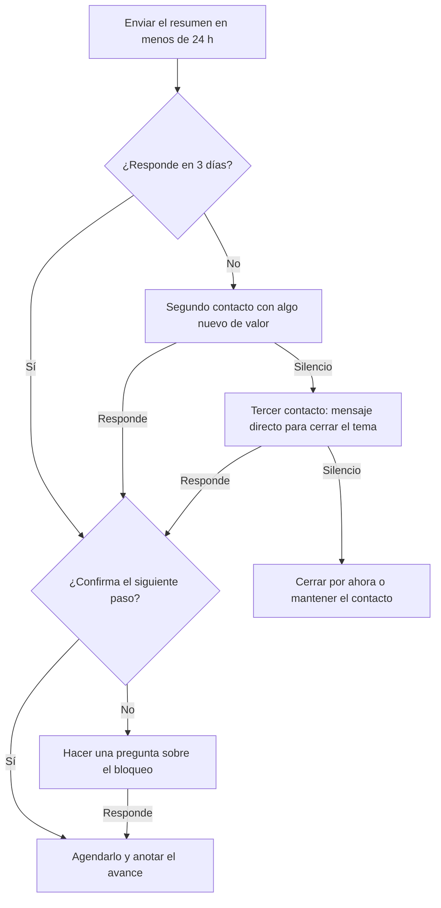

# Guía: Seguimiento

> **Objetivo:** después de cualquier reunión, enviar un resumen breve, confirmar el siguiente paso y reactivar los negocios en silencio sin presionar.
> **Etapas:** 2, 3, 4. **Puertas:** consulta [pipeline-stages](../stages/pipeline-stages.md). **Relacionadas:** [demo-call](./demo-call.md).

## Árbol de decisiones

## Situaciones

| Situación | Cuándo pasa | Qué decir | Guion |
| :--- | :--- | :--- | :--- |
| B1 | Acaba de terminar la reunión | Resume las decisiones, los responsables y el siguiente paso acordado en cinco líneas o menos. | — |
| B2 | Esperando respuesta | Espera 3 días hábiles antes del siguiente contacto. | — |
| B3 | El cliente respondió | Confirma por escrito el siguiente paso, el responsable y la fecha. | — |
| B4 | Sin respuesta | Aporta algo nuevo de valor (un caso de cliente, la respuesta a una duda pendiente), no un simple recordatorio. | — |
| B5 | Paso confirmado | Agenda la reunión, actualiza el registro de la llamada y anota que el negocio avanzó. | — |
| B6 | Responde sin comprometerse | "¿Qué tendría que pasar para que esto avance?" | — |
| B7 | Sigue en silencio | "¿Prefieres que lo dejemos por ahora, o es que no es el momento?" | — |
| B8 | No responde al mensaje de cierre | Ciérralo por ahora o mantén el contacto de vez en cuando, y registra el motivo. | — |

## Registro de aprendizajes

<!-- Formato: - YYYY-MM-DD vN->vN+1: cambio (evidencia: CALL-...) -->
- Todavía no hay entradas. `/retro` propone cambios aquí cuando haya suficientes llamadas registradas.
