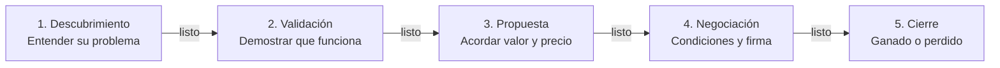

# Etapas del proceso de venta y criterios de cada puerta (`sales/stages/`)

> **Regla de trabajo:** un negocio pasa a la siguiente etapa solo cuando cumple todos los criterios de salida de su etapa actual y quedan anotados en el repositorio. Así el pronóstico se mantiene honesto.

---

## 1. Vista general del avance por etapas

---

## 2. Definición de etapas y criterios de salida

### Etapa 1: Descubrimiento
- **Probabilidad**: 10%
- **Duración objetivo**: 10 a 14 días naturales
- **Objetivo**: comprobar que el cliente potencial encaja con nuestro perfil de cliente ideal, entender el problema y lo que le cuesta, y averiguar quién decide.
- **Actividades clave**:
  - Hacer la llamada de descubrimiento con la guía de `sales/plays/discovery-call.md`.
  - Registrar la llamada en `sales/calls/YYYY-MM/` con `skill_call_analyzer.md`.
  - Revisar el negocio con `sales/qualification/qualification-matrix.md`.
- **Criterios de salida de la Puerta 1 (todos obligatorios para pasar a la Etapa 2)**:
  - [ ] **Problema entendido**: el cliente describió el problema y lo que le cuesta (tiempo, dinero u oportunidades perdidas).
  - [ ] **Buen encaje**: la empresa coincide con nuestro perfil de cliente ideal en `sales/icps/`.
  - [ ] **Aliado identificado**: al menos una persona de su lado quiere resolver el problema y nos ayudará.
  - [ ] **Persona que decide identificada**: nombre y cargo de quien aprueba el presupuesto.
  - [ ] **Siguiente reunión agendada**: hay una reunión de seguimiento en el calendario con una agenda clara.

---

### Etapa 2: Validación
- **Probabilidad**: 30%
- **Duración objetivo**: 14 a 21 días naturales
- **Objetivo**: demostrar que nuestra oferta resuelve su problema y reunirnos con la persona que decide.
- **Actividades clave**:
  - Hacer una demostración o prueba construida sobre su propia situación.
  - Responder las comparaciones con la competencia usando `sales/battlecards/`.
  - Compartir casos de clientes relevantes de `sales/case-studies/`.
- **Criterios de salida de la Puerta 2 (todos obligatorios para pasar a la Etapa 3)**:
  - [ ] **Encaje confirmado**: el cliente está de acuerdo en que nuestra oferta resuelve su problema y no quedan bloqueos abiertos.
  - [ ] **Reunión con la persona que decide**: hablamos directamente con quien aprueba el presupuesto.
  - [ ] **Sabemos qué le importa**: conocemos cómo van a elegir y nuestros puntos fuertes están en esa lista.
  - [ ] **Plan conjunto acordado**: ambas partes acordaron los siguientes pasos y una fecha objetivo para decidir.

---

### Etapa 3: Propuesta
- **Probabilidad**: 60%
- **Duración objetivo**: 14 a 20 días naturales
- **Objetivo**: acordar el valor y el precio, y enviar una propuesta por escrito.
- **Actividades clave**:
  - Presentar a la persona que decide el valor para ellos (lo que ahorran o ganan).
  - Resolver las dudas sobre el precio con `sales/objections/pricing-too-high.md`.
  - Involucrar a todas las personas que deben aprobar la compra (finanzas, legal, compras).
- **Criterios de salida de la Puerta 3 (todos obligatorios para pasar a la Etapa 4)**:
  - [ ] **Presupuesto confirmado**: la persona que decide está de acuerdo en que el valor lo justifica y el presupuesto está disponible.
  - [ ] **Propuesta enviada**: alcance, precio y opciones entregados por escrito.
  - [ ] **Somos la opción elegida**: el cliente dice que somos su opción preferida.

---

### Etapa 4: Negociación
- **Probabilidad**: 85%
- **Duración objetivo**: 14 a 30 días naturales
- **Objetivo**: acordar las condiciones finales y conseguir el contrato firmado.
- **Actividades clave**:
  - Revisar los cambios al contrato con su equipo legal o de compras.
  - Responder las revisiones que necesiten antes de comprar (por ejemplo, preguntas de seguridad o cumplimiento).
  - Acordar las condiciones de pago y los pasos para firmar.
- **Criterios de salida de la Puerta 4 (todos obligatorios para pasar a la Etapa 5)**:
  - [ ] **Aprobaciones listas**: el cliente tiene todas las aprobaciones internas que necesita.
  - [ ] **Condiciones acordadas**: ambas partes aceptan las condiciones del contrato.
  - [ ] **Contrato enviado a firma**: el contrato final está con la persona autorizada para firmarlo.

---

### Etapa 5: Cierre (ganado o perdido)
- **Ganado (100%)**:
  - Contrato firmado por ambas partes.
  - Reunión de arranque agendada con el equipo que atenderá al cliente.
  - Análisis del negocio ganado guardado en `sales/win-loss/` en un plazo de 5 días hábiles.
- **Perdido (0%)**:
  - El negocio se perdió, se canceló o se fue con un competidor.
  - Motivo principal registrado (falta una función, competidor, sin presupuesto, perdimos a nuestro aliado, otro).
  - Análisis del negocio perdido guardado en `sales/win-loss/` en un plazo de 5 días hábiles.

---

## 3. Ritmo por etapa y alertas de negocios estancados

| Etapa | Duración normal | Señal de alerta | Qué hacer |
| :--- | :--- | :--- | :--- |
| **Etapa 1: Descubrimiento** | 10 días | > 21 días sin segunda reunión | Pregunta directamente si sigue siendo una prioridad, o ciérralo por ahora. |
| **Etapa 2: Validación** | 18 días | > 35 días sin reunirse con la persona que decide | Pide a tu aliado que te presente; pausa el esfuerzo extra hasta que ocurra. |
| **Etapa 3: Propuesta** | 15 días | > 30 días sin respuesta a la propuesta | Vuelve a revisar el problema y el presupuesto con tu aliado. |
| **Etapa 4: Negociación** | 20 días | > 45 días en aprobaciones o revisión del contrato | Pide a alguien con un cargo directivo de nuestro lado que llame a la persona que decide. |

---

## 4. Mapas visuales del recorrido con Archify

Según `org-kernel.json` -> `ecosystemTools.salesFlowDiagrams`, el equipo puede mantener mapas del recorrido más detallados con **Archify** (`https://github.com/tt-a1i/archify`). Es opcional: la página del sistema de ventas ya dibuja este proceso y cada guía de llamada sin internet.

Cuando la retrospectiva mensual (`skill_monthly_retrospective.md`) encuentre una etapa donde los negocios se estancan una y otra vez, actualiza este archivo (y el mapa del recorrido, si usas uno) para agregar o reordenar pasos.
