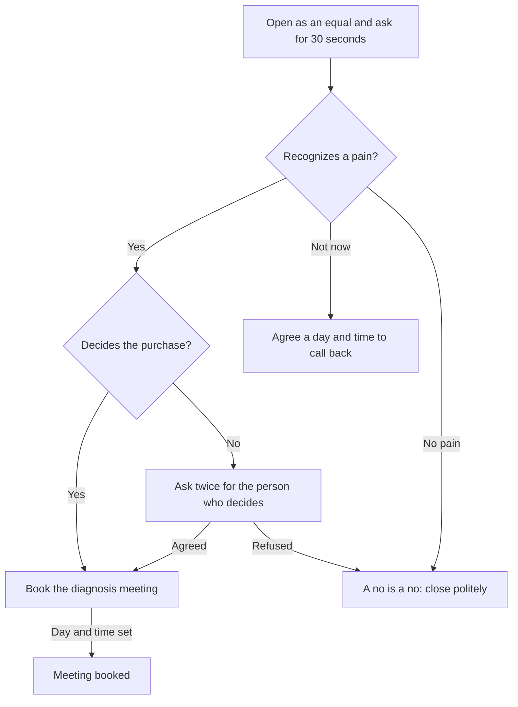

# Play: Cold Call

> **Goal:** in 2 to 5 minutes, say the 30-second commercial, check that the business recognizes a pain, and book the diagnosis meeting with the person who decides. Do not present the solution.
> **Stage:** 1. **Gate:** Gate 1 in [pipeline-stages](../stages/pipeline-stages.md). **Related:** [discovery-call](./discovery-call.md), [follow-up](./follow-up.md).

## Decision Tree

## Branches

| Branch | Trigger | Talk track | Script link |
| :--- | :--- | :--- | :--- |
| B1 | Prospect picks up | "Hi [name], this is [you] from [company]. You weren't expecting my call; can I take 30 seconds to tell you why I'm calling, and then you decide if we keep talking?" Then the 30-second commercial: three pain statements and "Does any of this sound familiar?" | — |
| B2 | Prospect answers the hook question | If yes: "Which one, and what does it look like for you?" (two or three opinion questions at most; this is not the diagnosis). | — |
| B3 | Pain recognized | "Besides you, who decides on something like this?" | — |
| B4 | "Not now" | "Fair enough. Is Thursday at 10 or Friday at 4 better for five minutes?" Log the day and time. | — |
| B5 | No pain or firm no | "Thanks for telling me clearly. If it ever comes up, you have my number." Log the reason. | — |
| B6 | Talking with the person who decides | "Let's take 20 minutes to see if this makes sense for you. If it doesn't, you tell me no without a problem. Does Tuesday at 10 work?" | — |
| B7 | Contact does not decide | "Often I explain this to someone on the team, it gets passed on and gets lost on the way. How about we look at it together with [name]?" | — |
| B8 | Meeting accepted | Send the invitation with day, time and purpose, and note in the call log that the deal moved forward. | — |

## Learnings Log

<!-- Format: - YYYY-MM-DD vN->vN+1: change (evidence: CALL-...) -->
- No entries yet. `/retro` proposes edits here after enough logged calls.
