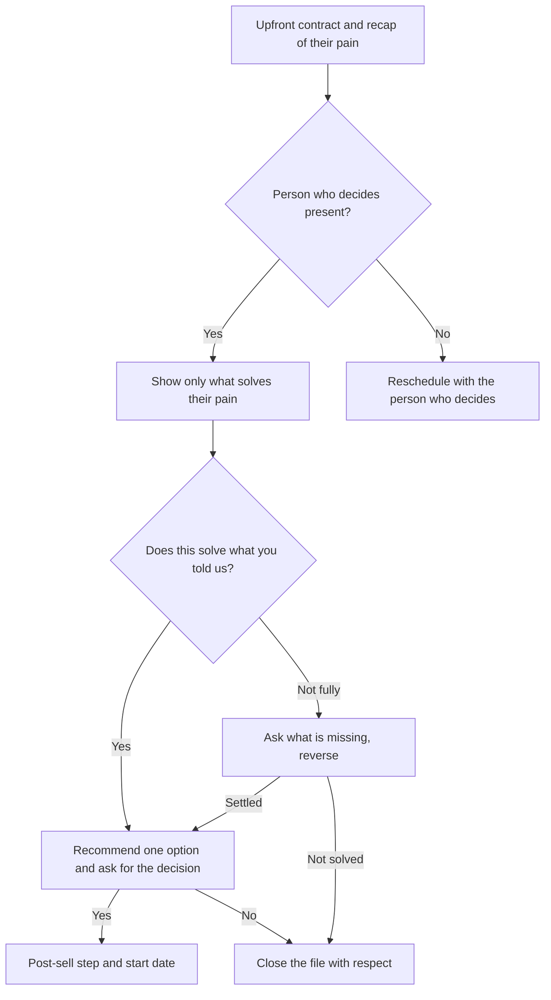

# Play: Presentation

> **Goal:** with the person who decides present, show only what solves the confirmed pain, ask if it solves it, recommend one option, and leave with a yes (plus the post-sell step) or a no.
> **Stages:** 4, 5. **Gate:** Gate 4 in [pipeline-stages](../stages/pipeline-stages.md). **Related:** [discovery-call](./discovery-call.md), [follow-up](./follow-up.md).

## Decision Tree

## Branches

| Branch | Trigger | Talk track | Script link |
| :--- | :--- | :--- | :--- |
| B1 | Presentation starts | "We have 30 minutes. Last time you told me [pain], which costs you about [amount] a month. I'll show only that part; at the end you tell me yes or no. Fair?" | — |
| B2 | Checking who is on the call | Confirm the person who decides is there before showing anything. | — |
| B3 | Person who decides present | Show only the part tied to their pain, with their own examples; skip everything else. | — |
| B4 | Person who decides missing | "This works best when [name] sees it. Shall we move it to a time they can join?" | — |
| B5 | Solution shown | "Does this solve what you told us?" Then hold the silence. | — |
| B6 | It solves the pain | Recommend one option that fits them: "From what you told me, this is the one. Shall we go ahead?" | — |
| B7 | Doubt or objection | Reverse: "What makes you say that?" Answer only from verified material; never invent features or prices. | — |
| B8 | A yes | "Could anything happen that would stop this before we start?" Agree the start date and note the win. | — |
| B9 | A no | "Thanks for telling me clearly." Log the reason and close the file. | — |

## Learnings Log

<!-- Format: - YYYY-MM-DD vN->vN+1: change (evidence: CALL-...) -->
- No entries yet. `/retro` proposes edits here after enough logged calls.
