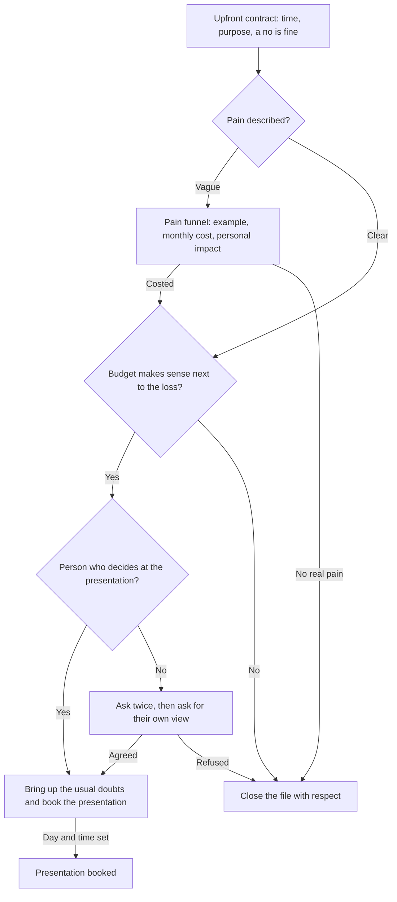

# Play: Diagnosis Call

> **Goal:** set the upfront contract, go down the pain funnel until the prospect costs the pain, then qualify budget and decision, and book the presentation with the person who decides.
> **Stages:** 2, 3. **Gates:** Gates 2 and 3 in [pipeline-stages](../stages/pipeline-stages.md). **Related:** [cold-call](./cold-call.md), [demo-call](./demo-call.md).

## Decision Tree

## Branches

| Branch | Trigger | Talk track | Script link |
| :--- | :--- | :--- | :--- |
| B1 | Meeting starts | "We have 20 minutes. I'll ask you how you work today; if it makes sense, we book a next step, and if not, you tell me no freely. Fair?" | — |
| B2 | Prospect describes a problem | Mirror it back in one sentence and ask an opinion question: "How comfortable are you with that?" Then hold the silence. | — |
| B3 | Answers stay vague | "Can you give me a recent example? How many times a month does it happen? What is each one worth?" Let them work out the figure. | — |
| B4 | Pain costed | "If you stop losing that [amount] each month, how much would it make sense to invest each month to fix it?" | — |
| B5 | Budget makes sense | "Besides you, who takes part in this decision, and by when would you like it working?" | — |
| B6 | Person who decides confirmed | "Usually three doubts come up here: who else needs to see it, how long it takes to start, and the price. Does any apply?" Then book the presentation. | — |
| B7 | Person who decides not on the call | Ask a second time with a third-party story; if impossible: "If it were up to you, would you go ahead?" | — |
| B8 | No real pain, no budget or no access | Close the file with the matching script in the qualification matrix and log the reason. | — |
| B9 | Presentation booked | Note in the call log that the deal moved forward, with the monthly cost and the date to decide. | — |

## Learnings Log

<!-- Format: - YYYY-MM-DD vN->vN+1: change (evidence: CALL-...) -->
- No entries yet. `/retro` proposes edits here after enough logged calls.
