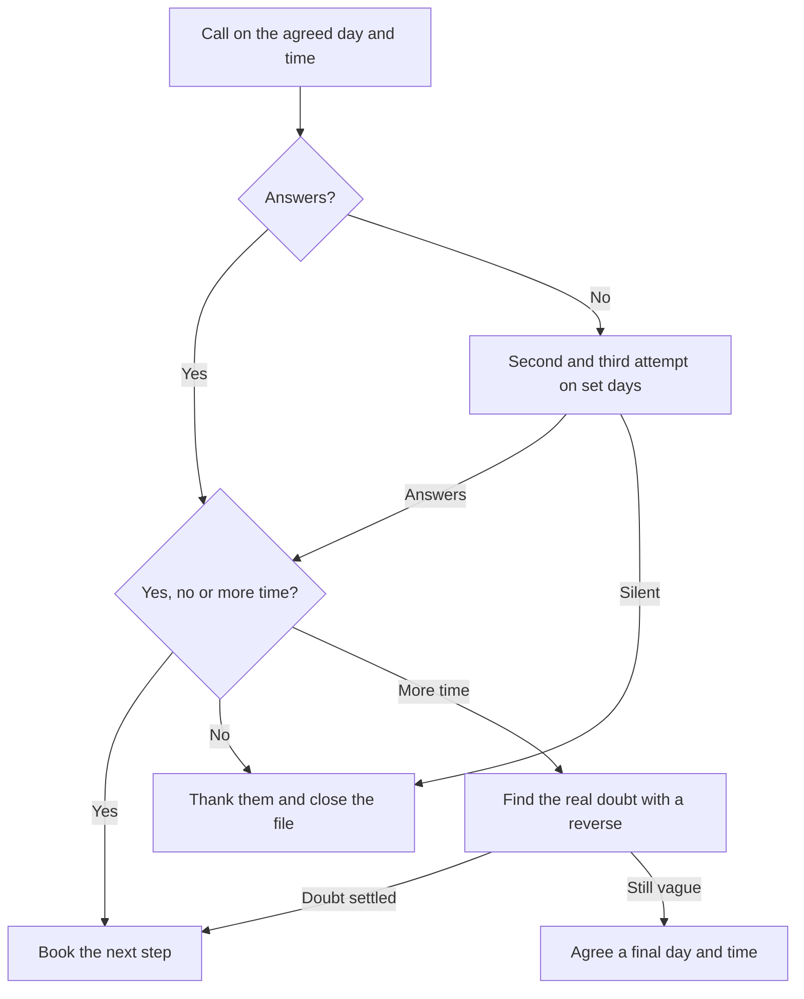

# Play: Follow-up

> **Goal:** call on the agreed day, ask for a yes or a no, and never leave a "let me think about it" without a day and time. Close the sale or close the file.
> **Stages:** 1, 3, 4. **Gates:** see [pipeline-stages](../stages/pipeline-stages.md). **Related:** [cold-call](./cold-call.md), [demo-call](./demo-call.md).

## Decision Tree

## Branches

| Branch | Trigger | Talk track | Script link |
| :--- | :--- | :--- | :--- |
| B1 | Agreed follow-up day | "We agreed to talk today to see if we go ahead or not. Where are you?" | — |
| B2 | Waiting for an answer | Call, do not just send messages. | — |
| B3 | Prospect answers | Ask for a clear answer: "Is it a yes, a no, or is something missing?" | — |
| B4 | No answer | Two more attempts on set days and times, each with a short message. | — |
| B5 | A yes or a settled doubt | Book the next step with a day and time and note in the call log that the deal moved forward. | — |
| B6 | A no, or three attempts with no answer | "Thanks for telling me clearly." Log the reason and close the file. | — |
| B7 | "Let me think about it" | Reverse: "Usually when someone tells me that, there is a doubt left. What is it?" | — |
| B8 | Still no answer | "Shall we leave it for [day] at [time], and if it is not for you, you tell me no?" | — |

## Learnings Log

<!-- Format: - YYYY-MM-DD vN->vN+1: change (evidence: CALL-...) -->
- No entries yet. `/retro` proposes edits here after enough logged calls.
