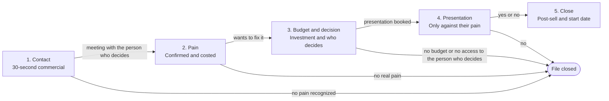

# Sales Pipeline Stages & Gate Criteria (`sales/stages/`)

> **Operating Standard:** A deal moves to the next stage only when every exit criterion of its current stage is met and noted in the repository. The order is fixed: pain, budget and decision come before any presentation. Every conversation ends with a yes, a no, or a next step with a day and time (close the sale or close the file).

---

## 1. Pipeline Stage Progression Overview

---

## 2. Stage Definitions & Gate Exit Criteria

> Durations are internal team targets for short sales cycles, not market data. Adjust them in the monthly retrospective once calls are logged.

### Stage 1: Contact
- **Target duration (internal target)**: 1 to 7 days from the first contact.
- **Objective**: introduce yourself with the 30-second commercial, see if the business recognizes a pain, and book the diagnosis meeting with the person who decides.
- **Key Activities**:
  - Short cold call (2 to 5 minutes) using the guide in `sales/plays/cold-call.md`.
  - If someone who does not decide answers: ask twice for the meeting with the person who decides.
  - Log the call in `sales/calls/YYYY-MM/` using `skill_call_analyzer.md`.
- **Gate 1 Exit Criteria (all required to move to Stage 2)**:
  - [ ] **Recognized a pain**: the prospect said yes to "Does any of this sound familiar?" or described a problem of their own.
  - [ ] **We know who decides**: name and role of the person who approves the purchase.
  - [ ] **Meeting booked with the person who decides**: day and time on the calendar, invitation sent. "Send me the information and call me tomorrow" does not count.

---

### Stage 2: Pain
- **Target duration (internal target)**: 0 to 3 days (often done in the same diagnosis meeting).
- **Objective**: understand what not fixing the problem costs the business today and whether they want to fix it.
- **Key Activities**:
  - Upfront contract at the start of the meeting: time, purpose, permission to say no, next step.
  - Pain funnel with opinion questions, using the guide in `sales/plays/discovery-call.md`.
  - Check the deal against `sales/qualification/qualification-matrix.md`.
- **Gate 2 Exit Criteria (all required to move to Stage 3)**:
  - [ ] **Upfront contract set**: both sides agreed on time, purpose, the right to say no, and the next step.
  - [ ] **Pain in their words**: the prospect described the problem with a concrete example.
  - [ ] **Pain costed**: there is an approximate monthly figure of what they lose (sales, bookings or team hours), worked out by the prospect.
  - [ ] **Wants to fix it**: they said fixing it matters now, not "someday".

---

### Stage 3: Budget and decision
- **Target duration (internal target)**: 0 to 5 days.
- **Objective**: confirm the investment makes sense next to the loss, and that the person who decides will be at the presentation.
- **Key Activities**:
  - Budget question tied to the monthly cost of the pain.
  - If the person who decides was not there: ask your contact twice to bring them; if that is impossible, ask for their own view ("If it were up to you, would you go ahead?").
  - Bring up the usual doubts before the presentation (who else decides, time to get started, price).
- **Gate 3 Exit Criteria (all required to move to Stage 4)**:
  - [ ] **Budget accepted**: the prospect agrees that investing makes sense next to what they lose each month.
  - [ ] **Person who decides confirmed**: they confirmed they will be at the presentation.
  - [ ] **Process and date to decide**: we know how they decide and by when.
  - [ ] **Presentation booked**: day and time on the calendar.

---

### Stage 4: Presentation
- **Target duration (internal target)**: 1 to 7 days from the diagnosis meeting.
- **Objective**: show the solution working, only against the confirmed pain, with the person who decides present.
- **Key Activities**:
  - Presentation using the guide in `sales/plays/demo-call.md`.
  - Recommend one option that fits their size and needs.
  - If they use another provider, compare using `sales/battlecards/`.
- **Gate 4 Exit Criteria (all required to move to Stage 5)**:
  - [ ] **The person who decides saw it**.
  - [ ] **Confirmed it solves their pain**: they said yes to "Does this solve what you told us?".
  - [ ] **Decision made**: a yes with the option chosen, or a no.

---

### Stage 5: Close (Won or Lost)
- **Won**:
  - Option chosen and start date agreed.
  - Post-sell step done: "Could anything happen that would stop this?".
  - Win review saved in `sales/win-loss/` within 5 business days.
- **Lost (file closed)**:
  - A clear no, or three attempts with no answer after the agreed follow-up.
  - Main reason recorded (no pain, no budget, no access to the person who decides, stays with what they have, other).
  - Loss review saved in `sales/win-loss/` within 5 business days.

---

## 3. Stage Velocity & Stuck-Deal Alerts

| Stage | Normal Duration (internal target) | Warning Sign | What to Do |
| :--- | :--- | :--- | :--- |
| **Stage 1: Contact** | 3 days | > 7 days without a meeting with the person who decides | Call once more asking for that meeting; if there is no date, close the file. |
| **Stage 2: Pain** | 1 day | > 3 days without a costed pain | Book 10 minutes to finish the pain funnel; if there is no real pain, close the file. |
| **Stage 3: Budget and decision** | 3 days | > 5 days without a presentation booked with the person who decides | Ask a second time for the person who decides; if they refuse, ask for your contact's own view or close the file. |
| **Stage 4: Presentation** | 5 days | > 7 days without a decision after the presentation | Call on the agreed day and ask for a yes or a no. |

---

## 4. Visual Journey Mapping via Archify

Per `org-kernel.json` -> `ecosystemTools.salesFlowDiagrams`, the team can keep richer journey maps with **Archify** (`https://github.com/tt-a1i/archify`). This is optional: the sales system page already draws this pipeline and every call guide without internet.

When the monthly retrospective (`skill_monthly_retrospective.md`) finds a stage where deals keep getting stuck, update this file (and the journey map, if you use one) to add or reorder steps.
