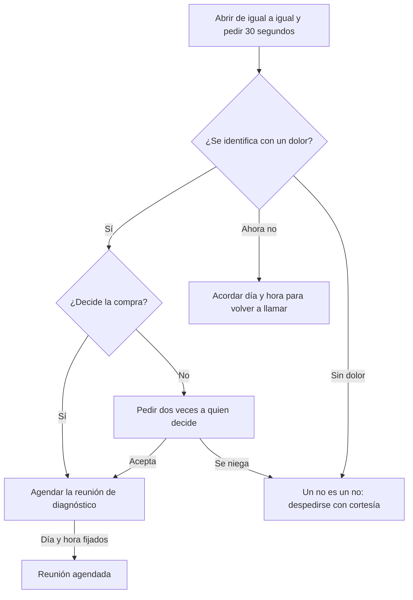

# Guía: Llamada en frío

> **Objetivo:** en 2 a 5 minutos, decir el comercial de 30 segundos, comprobar que el negocio se identifica con un dolor y agendar la reunión de diagnóstico con quien decide. No presentes la solución.
> **Etapa:** 1. **Puerta:** Puerta 1 en [pipeline-stages](../stages/pipeline-stages.md). **Relacionadas:** [discovery-call](./discovery-call.md), [follow-up](./follow-up.md).

## Árbol de decisiones

## Situaciones

| Situación | Cuándo pasa | Qué decir | Guion |
| :--- | :--- | :--- | :--- |
| B1 | El cliente contesta | "Hola, [nombre], te habla [tú] de [empresa]. No esperabas mi llamada; ¿me das 30 segundos para contarte por qué te llamo y luego decides si seguimos?" Luego el comercial de 30 segundos: tres enunciados de dolor y "¿Te suena alguna de estas situaciones?" | — |
| B2 | El cliente responde a la pregunta gancho | Si dice que sí: "¿Cuál de ellas, y cómo se ve en tu negocio?" (dos o tres preguntas de juicio como máximo; esto no es el diagnóstico). | — |
| B3 | Se identifica con un dolor | "Además de ti, ¿quién decide algo así?" | — |
| B4 | "Ahora no" | "Lo entiendo. ¿Te va mejor el jueves a las 10 o el viernes a las 4, cinco minutos?" Anota el día y la hora. | — |
| B5 | Sin dolor o un no rotundo | "Gracias por decírmelo claro. Si algún día lo necesitas, tienes mi número." Registra el motivo. | — |
| B6 | Hablas con quien decide | "Tomemos 20 minutos para ver si esto tiene sentido para ti. Si no lo tiene, me dices que no sin problema. ¿Te va bien el martes a las 10?" | — |
| B7 | Tu contacto no decide | "Muchas veces le explico esto a alguien del equipo, se lo pasa a quien decide y se pierde en el camino. ¿Qué tal si lo vemos juntos con [nombre]?" | — |
| B8 | Acepta la reunión | Envía la invitación con día, hora y propósito, y anota en el registro de la llamada que el negocio avanzó. | — |

## Registro de aprendizajes

<!-- Formato: - YYYY-MM-DD vN->vN+1: cambio (evidencia: CALL-...) -->
- Todavía no hay entradas. `/retro` propone cambios aquí cuando haya suficientes llamadas registradas.
