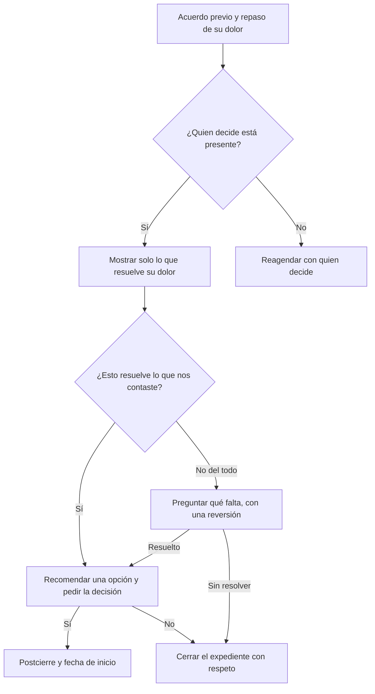

# Guía: Presentación

> **Objetivo:** con quien decide presente, mostrar solo lo que resuelve el dolor confirmado, preguntar si lo resuelve, recomendar una sola opción y salir con un sí (y el paso del postcierre) o con un no.
> **Etapas:** 4, 5. **Puerta:** Puerta 4 en [pipeline-stages](../stages/pipeline-stages.md). **Relacionadas:** [discovery-call](./discovery-call.md), [follow-up](./follow-up.md).

## Árbol de decisiones

## Situaciones

| Situación | Cuándo pasa | Qué decir | Guion |
| :--- | :--- | :--- | :--- |
| B1 | Empieza la presentación | "Tenemos 30 minutos. La vez pasada me contaste [dolor], que les cuesta unos [monto] al mes. Te muestro solo esa parte y al final me dices sí o no. ¿Te parece?" | — |
| B2 | Revisas quién está en la llamada | Confirma que quien decide está presente antes de mostrar nada. | — |
| B3 | Quien decide está presente | Muestra solo la parte ligada a su dolor, con ejemplos de su negocio; deja fuera todo lo demás. | — |
| B4 | Falta quien decide | "Esto funciona mejor cuando [nombre] lo ve. ¿Lo movemos a un momento en que pueda estar?" | — |
| B5 | Ya mostraste la solución | "¿Esto resuelve lo que nos contaste?" Luego sostén el silencio. | — |
| B6 | Resuelve el dolor | Recomienda una sola opción que le corresponda: "Por lo que me contaste, esta es la que te sirve. ¿Avanzamos?" | — |
| B7 | Duda u objeción | Reversión: "¿Qué te hace decir eso?" Responde solo con información verificada; nunca inventes funciones ni precios. | — |
| B8 | Un sí | "¿Podría pasar algo para que esto se frene antes de empezar?" Acuerda la fecha de inicio y registra el negocio ganado. | — |
| B9 | Un no | "Gracias por decírmelo claro." Registra el motivo y cierra el expediente. | — |

## Registro de aprendizajes

<!-- Formato: - YYYY-MM-DD vN->vN+1: cambio (evidencia: CALL-...) -->
- Todavía no hay entradas. `/retro` propone cambios aquí cuando haya suficientes llamadas registradas.
