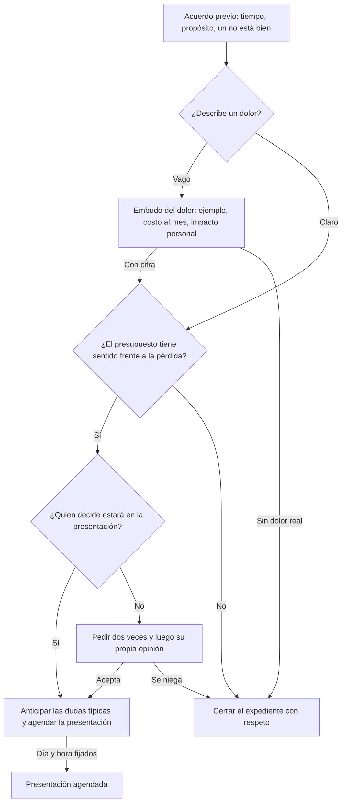

# Guía: Llamada de diagnóstico

> **Objetivo:** fijar el acuerdo previo, bajar por el embudo del dolor hasta que el prospecto le ponga cifra al dolor, luego calificar presupuesto y decisión, y agendar la presentación con quien decide.
> **Etapas:** 2, 3. **Puertas:** Puertas 2 y 3 en [pipeline-stages](../stages/pipeline-stages.md). **Relacionadas:** [cold-call](./cold-call.md), [demo-call](./demo-call.md).

## Árbol de decisiones

## Situaciones

| Situación | Cuándo pasa | Qué decir | Guion |
| :--- | :--- | :--- | :--- |
| B1 | Empieza la reunión | "Tenemos 20 minutos. Te voy a preguntar cómo trabajan hoy; si tiene sentido, agendamos un siguiente paso, y si no, me dices que no con toda libertad. ¿Te parece?" | — |
| B2 | El cliente describe un problema | Repítelo en una frase y haz una pregunta de juicio: "¿Qué tan conforme estás con eso?" Luego sostén el silencio. | — |
| B3 | Las respuestas siguen vagas | "¿Me das un ejemplo reciente? ¿Cuántas veces pasa al mes? ¿Cuánto vale cada una?" Deja que el cliente calcule la cifra. | — |
| B4 | El dolor tiene cifra | "Si dejas de perder esos [monto] al mes, ¿cuánto tendría sentido invertir al mes para resolverlo?" | — |
| B5 | El presupuesto tiene sentido | "Además de ti, ¿quién participa en esta decisión y para cuándo te gustaría tenerlo funcionando?" | — |
| B6 | Quien decide está confirmado | "En este punto suelen surgir tres dudas: quién más tiene que verlo, cuánto tarda en arrancar y el precio. ¿Alguna aplica?" Luego agenda la presentación. | — |
| B7 | Quien decide no está en la llamada | Pide una segunda vez con una historia de terceros; si es imposible: "Si por ti fuera, ¿avanzarías?" | — |
| B8 | Sin dolor real, sin presupuesto o sin acceso | Cierra el expediente con el guion que corresponde en la matriz de calificación y registra el motivo. | — |
| B9 | Presentación agendada | Anota en el registro de la llamada que el negocio avanzó, con el costo al mes y la fecha para decidir. | — |

## Registro de aprendizajes

<!-- Formato: - YYYY-MM-DD vN->vN+1: cambio (evidencia: CALL-...) -->
- Todavía no hay entradas. `/retro` propone cambios aquí cuando haya suficientes llamadas registradas.
