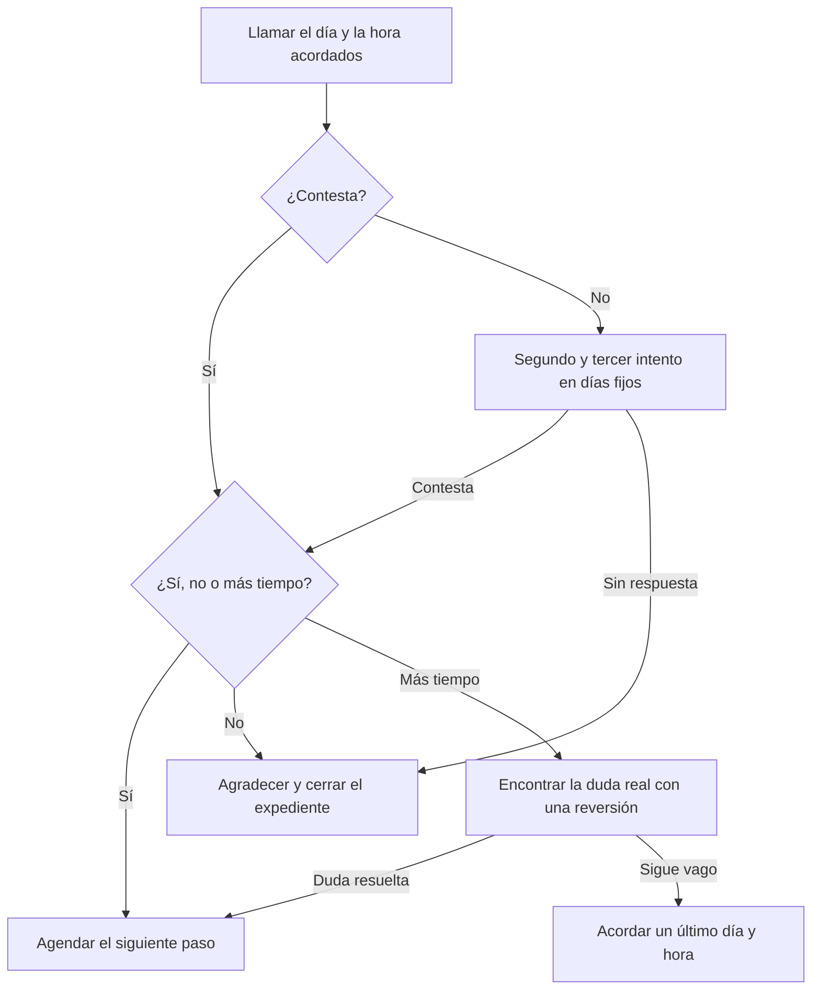

# Guía: Seguimiento

> **Objetivo:** llamar el día acordado, pedir un sí o un no y nunca dejar un "lo voy a pensar" sin día y hora. Cierra la venta o cierra el expediente.
> **Etapas:** 1, 3, 4. **Puertas:** ver [pipeline-stages](../stages/pipeline-stages.md). **Relacionadas:** [cold-call](./cold-call.md), [demo-call](./demo-call.md).

## Árbol de decisiones

## Situaciones

| Situación | Cuándo pasa | Qué decir | Guion |
| :--- | :--- | :--- | :--- |
| B1 | Día de seguimiento acordado | "Quedamos en hablar hoy para ver si avanzamos o no. ¿Cómo lo ves?" | — |
| B2 | Esperas una respuesta | Llama; no te quedes solo en mensajes. | — |
| B3 | El cliente contesta | Pide una respuesta clara: "¿Es un sí, un no, o falta algo?" | — |
| B4 | No contesta | Dos intentos más en días y horas fijos, cada uno con un mensaje corto. | — |
| B5 | Un sí o una duda resuelta | Agenda el siguiente paso con día y hora y anota en el registro de la llamada que el negocio avanzó. | — |
| B6 | Un no, o tres intentos sin respuesta | "Gracias por decírmelo claro." Registra el motivo y cierra el expediente. | — |
| B7 | "Lo voy a pensar" | Reversión: "Normalmente, cuando alguien me dice eso, queda alguna duda. ¿Cuál es?" | — |
| B8 | Sigue sin respuesta clara | "¿Lo dejamos para el [día] a las [hora], y si no es para ti, me dices que no?" | — |

## Registro de aprendizajes

<!-- Formato: - YYYY-MM-DD vN->vN+1: cambio (evidencia: CALL-...) -->
- Todavía no hay entradas. `/retro` propone cambios aquí cuando haya suficientes llamadas registradas.
