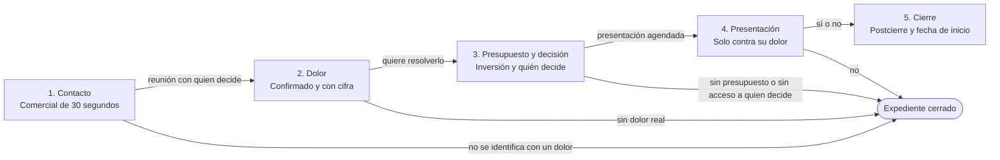

# Etapas del proceso de venta y criterios de cada puerta (`sales/stages/`)

> **Regla de trabajo:** un negocio pasa a la siguiente etapa solo cuando cumple todos los criterios de salida de su etapa actual y quedan anotados en el repositorio. El orden es fijo: dolor, presupuesto y decisión van antes de cualquier presentación. Cada conversación termina con un sí, un no o un siguiente paso con día y hora (cierra la venta o cierra el expediente).

---

## 1. Vista general del avance por etapas

---

## 2. Definición de etapas y criterios de salida

> Las duraciones son metas internas del equipo para ciclos de venta cortos, no datos de mercado. Ajústalas en la retrospectiva mensual cuando haya llamadas registradas.

### Etapa 1: Contacto
- **Duración objetivo (meta interna)**: de 1 a 7 días desde el primer contacto.
- **Objetivo**: presentarte con el comercial de 30 segundos, ver si el negocio se identifica con algún dolor y agendar la reunión de diagnóstico con quien decide.
- **Actividades clave**:
  - Llamada en frío corta (2 a 5 minutos) con la guía de `sales/plays/cold-call.md`.
  - Si contesta alguien que no decide: pedir dos veces la reunión con quien decide.
  - Registrar la llamada en `sales/calls/YYYY-MM/` con `skill_call_analyzer.md`.
- **Criterios de salida de la Puerta 1 (todos obligatorios para pasar a la Etapa 2)**:
  - [ ] **Se identificó con un dolor**: respondió que sí a "¿Te suena alguna de estas situaciones?" o contó un problema propio.
  - [ ] **Sabemos quién decide**: nombre y cargo de quien aprueba la compra.
  - [ ] **Reunión agendada con quien decide**: día y hora en el calendario, con invitación enviada. "Mándame la información y te llamo mañana" no cuenta.

---

### Etapa 2: Dolor
- **Duración objetivo (meta interna)**: de 0 a 3 días (suele resolverse en la misma reunión de diagnóstico).
- **Objetivo**: entender qué le cuesta hoy al negocio no resolver el problema y si quiere resolverlo.
- **Actividades clave**:
  - Acuerdo previo al inicio de la reunión: tiempo, propósito, permiso para decir que no y siguiente paso.
  - Embudo del dolor con preguntas de juicio, con la guía de `sales/plays/discovery-call.md`.
  - Revisar el negocio con `sales/qualification/qualification-matrix.md`.
- **Criterios de salida de la Puerta 2 (todos obligatorios para pasar a la Etapa 3)**:
  - [ ] **Acuerdo previo hecho**: los dos acordaron tiempo, propósito, el derecho a decir que no y el siguiente paso.
  - [ ] **Dolor en sus palabras**: el prospecto describió el problema con un ejemplo concreto.
  - [ ] **Dolor con cifra**: hay una cifra mensual aproximada de lo que pierde (ventas, reservas u horas del equipo), calculada por el prospecto.
  - [ ] **Quiere resolverlo**: dijo que le importa resolverlo ahora, no "algún día".

---

### Etapa 3: Presupuesto y decisión
- **Duración objetivo (meta interna)**: de 0 a 5 días.
- **Objetivo**: confirmar que la inversión tiene sentido frente a la pérdida y que quien decide estará en la presentación.
- **Actividades clave**:
  - Pregunta de presupuesto ligada al costo al mes del dolor.
  - Si quien decide no estuvo: pedirle dos veces a tu contacto que lo traiga; si es imposible, pedir su propia opinión ("Si por ti fuera, ¿avanzarías?").
  - Anticipar las dudas típicas antes de la presentación (quién más decide, tiempo para arrancar, precio).
- **Criterios de salida de la Puerta 3 (todos obligatorios para pasar a la Etapa 4)**:
  - [ ] **Presupuesto aceptado**: el prospecto acepta que invertir tiene sentido frente a lo que pierde al mes.
  - [ ] **Quien decide confirmado**: confirmó que estará en la presentación.
  - [ ] **Proceso y fecha para decidir**: sabemos cómo deciden y para cuándo.
  - [ ] **Presentación agendada**: día y hora en el calendario.

---

### Etapa 4: Presentación
- **Duración objetivo (meta interna)**: de 1 a 7 días desde la reunión de diagnóstico.
- **Objetivo**: mostrar la solución funcionando, solo contra el dolor confirmado, con quien decide presente.
- **Actividades clave**:
  - Presentación con la guía de `sales/plays/demo-call.md`.
  - Recomendar una sola opción que corresponda a su tamaño y necesidades.
  - Si ya usan otro proveedor, comparar con `sales/battlecards/`.
- **Criterios de salida de la Puerta 4 (todos obligatorios para pasar a la Etapa 5)**:
  - [ ] **Quien decide lo vio**.
  - [ ] **Confirmó que resuelve su dolor**: respondió que sí a "¿Esto resuelve lo que nos contaste?".
  - [ ] **Decisión tomada**: un sí con la opción elegida, o un no.

---

### Etapa 5: Cierre (ganado o perdido)
- **Ganado**:
  - Opción elegida y fecha de inicio acordada.
  - Paso del postcierre hecho: "¿Podría pasar algo para que esto se frene?".
  - Análisis del negocio ganado guardado en `sales/win-loss/` en un plazo de 5 días hábiles.
- **Perdido (expediente cerrado)**:
  - Un no claro, o tres intentos sin respuesta después del seguimiento acordado.
  - Motivo principal registrado (sin dolor, sin presupuesto, sin acceso a quien decide, se queda con lo que tiene, otro).
  - Análisis del negocio perdido guardado en `sales/win-loss/` en un plazo de 5 días hábiles.

---

## 3. Ritmo por etapa y alertas de negocios estancados

| Etapa | Duración normal (meta interna) | Señal de alerta | Qué hacer |
| :--- | :--- | :--- | :--- |
| **Etapa 1: Contacto** | 3 días | > 7 días sin reunión con quien decide | Llama una vez más pidiendo esa reunión; si no hay fecha, cierra el expediente. |
| **Etapa 2: Dolor** | 1 día | > 3 días sin dolor con cifra | Agenda 10 minutos para terminar el embudo del dolor; si no hay dolor real, cierra el expediente. |
| **Etapa 3: Presupuesto y decisión** | 3 días | > 5 días sin presentación agendada con quien decide | Pide por segunda vez a quien decide; si se niega, pide la opinión de tu contacto o cierra el expediente. |
| **Etapa 4: Presentación** | 5 días | > 7 días sin decisión después de la presentación | Llama el día acordado y pide un sí o un no. |

---

## 4. Mapas visuales del recorrido con Archify

Según `org-kernel.json` -> `ecosystemTools.salesFlowDiagrams`, el equipo puede mantener mapas del recorrido más detallados con **Archify** (`https://github.com/tt-a1i/archify`). Es opcional: la página del sistema de ventas ya dibuja este proceso y cada guía de llamada sin internet.

Cuando la retrospectiva mensual (`skill_monthly_retrospective.md`) encuentre una etapa donde los negocios se estancan una y otra vez, actualiza este archivo (y el mapa del recorrido, si usas uno) para agregar o reordenar pasos.
